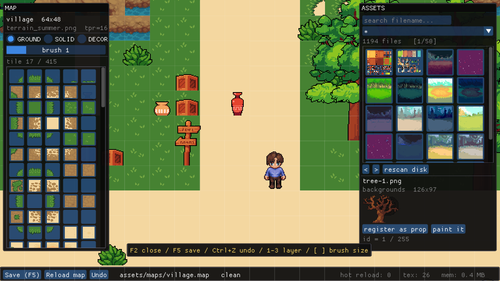

# 03g · 实时编辑器与热重载（阶段 24）

> 这一册解决一个很具体的问题：
>
> **游戏正在跑，我按一下 F2，弹出一个编辑器；改完地图点保存，
> 再点一下 Reload，世界立刻变成新的 —— 不重启、不重编译、不丢玩家。**
>
> 顺手还把"1194 张素材怎么用"解决了：编辑器里能翻、能预览、能直接往地图上放，
> 存下来的是一张 `props.cfg` + 改过的 `.map`。
>
> 到这一册结束，你会得到一个能用的关卡编辑器，而不是一个只能看的 demo。

---

## 24.0 先看清目标

### 按 F2 之后长什么样



左边是地图面板：

```
┌─────────────────────────┐
│ MAP                     │
│ village  64x48          │
│ terrain_summer.png      │
│ ○ GROUND ● SOLID ○ DECOR│  ← 三个图层
│ brush 1                 │
│ ┌───┬───┬───┬───┐       │
│ │t17│t18│t19│t20│  ...  │  ← 图集调色板（415 个 tile）
│ └───┴───┴───┴───┘       │
└─────────────────────────┘
```

右边是素材面板：

```
┌──────────────────────────────┐
│ ASSETS                       │
│ [ search filename...      ]  │
│ [ *                       v] │  ← 分类：backgrounds / chars / ...
│ 1194 files      [ 1 / 50 ]   │
│ ┌──┐┌──┐┌──┐┌──┐┌──┐         │
│ │  ││  ││  ││  ││  │  ...    │  ← 缩略图，点一下就选中
│ └──┘└──┘└──┘└──┘└──┘         │
│ tree-1.png                   │
│ backgrounds  126x97          │
│ [register as prop] [paint it]│
│ id = 1 / 255                 │
└──────────────────────────────┘
```

底部状态栏：

```
[Save (F5)] [Reload map] [Undo]   assets/maps/village.map  clean
                              hot reload: 0  tex: 26  mem: 0.4 MB
```

### 操作表

| 操作 | 效果 |
|------|------|
| `F2` | 开 / 关编辑器（游戏暂停，相机还能挪） |
| `WASD` | 平移相机 |
| `左键` | 按当前图层画：地形 / 碰撞 / 装饰 |
| `右键` | 擦 |
| `中键` | 吸管：把鼠标下的 tile 或道具捡成当前画笔 |
| `1` `2` `3` | 切 GROUND / SOLID / DECOR |
| `[` `]` | 画笔大小 1 → 3 → 5 |
| `Ctrl+Z` | 撤销上一笔 |
| `F5` | 保存 `.map` + `props.cfg` |
| `Reload map` | 从磁盘重读地图（玩家位置、血量保住） |
| 滚轮 / `<` `>` | 素材翻页 |

### 这一册和上一册（F1）的关系

- `F1` 那版是**手搓**的：没有依赖，但只有一个调色板和三种颜色，
  想加个搜索框得自己写 200 行命中测试。
- `F2` 这版是**ImGui**的：控件、搜索、拖拽、滚动全都现成，
  我们只用写"点了这个按钮要干什么"。

**两版都留着**。F1 用来理解原理（坐标换算、命中测试、调色板 UV），
F2 才是你真正会用来做关卡的工具。互斥：开一个自动关另一个。

---

## 24.1 为什么可以"在游戏里"编辑

一句话：**因为编辑器和游戏用的是同一份内存。**

```
        ┌──────────────────────────────────────────┐
        │ Game                                     │
        │                                          │
        │   TileMap map_      ←── 编辑器改的就是它  │
        │   PropSet props_    ←── 同上             │
        │   AssetBank bank_   ←── 同上             │
        │                                          │
        │   render() {                             │
        │       draw_world();     // 用 map_ 画     │
        │       draw_entities();  // 用 map_ 排    │
        │       editor.draw();    // 用 map_ 改    │
        │   }                                      │
        └──────────────────────────────────────────┘
```

编辑器不读文件的副本，不维护"编辑态地图"再同步。
它拿的就是 `Game::map_` 的指针，画一笔就是改那一格。

**这就是为什么"改完立刻生效"是免费的** —— 下一帧 `draw_world()`
读到的已经是新值。真正需要额外工作的是另外两件事：

1. **让 UI 显示出来**（ImGui 接线，24.2–24.5）
2. **让磁盘上的变化回到内存**（热重载，24.6–24.10）

第 2 件才是"热加载"三个字的重点：
你按 Save 写盘；按 Reload 是把盘上的读回来。两者都发生在一个进程里。

> ⚠ 一个常见误解：以为"热加载"是重新执行一遍初始化。
> 不是。重读地图时如果直接 `map_ = TileMap::load(...)`，
> 玩家会被扔回出生点、实体全部重生、血量回满 —— 那不叫热加载，叫重开。
> 24.11 会写 `reload_map_live()`，专门解决"保住玩家状态"。

---

## 24.2 把 ImGui 放进项目

### 24.2.1 要哪些文件

ImGui 不是 header-only，必须编 6 个 `.cpp`：

```
Thirdparty/
└── imgui/                       ← 版本 1.89.7
    ├── imgui.cpp                ┐
    ├── imgui_draw.cpp           │ 核心四个
    ├── imgui_tables.cpp         │
    ├── imgui_widgets.cpp        ┘
    ├── imgui.h
    ├── imgui_internal.h
    ├── imconfig.h
    ├── imstb_rectpack.h         ┐ 三个 stb 头，imgui 自己用
    ├── imstb_textedit.h         │
    ├── imstb_truetype.h         ┘
    └── backends/
        ├── imgui_impl_sdl2.cpp          ┐ 平台后端：键鼠、窗口
        ├── imgui_impl_sdl2.h            ┘
        ├── imgui_impl_sdlrenderer2.cpp  ┐ 渲染后端：把三角形画出来
        └── imgui_impl_sdlrenderer2.h    ┘
```

#### 怎么拿到这些文件

三条路，选最顺手的：

```bash
# A. git（要的就是某一个 tag，别拉 master）
git clone --depth 1 --branch v1.89.7 https://github.com/ocornut/imgui.git _imgui
cp _imgui/imgui.cpp _imgui/imgui_draw.cpp _imgui/imgui_tables.cpp _imgui/imgui_widgets.cpp Thirdparty/imgui/
cp _imgui/imgui.h _imgui/imgui_internal.h _imgui/imconfig.h _imgui/imstb_*.h Thirdparty/imgui/
cp _imgui/backends/imgui_impl_sdl2.* _imgui/backends/imgui_impl_sdlrenderer2.* Thirdparty/imgui/backends/
cp _imgui/LICENSE.txt Thirdparty/imgui/

# B. 下 zip
#    https://github.com/ocornut/imgui/archive/refs/tags/v1.89.7.zip
#    解压后同样只拷上面列的文件

# C. 你已经装过 imgui-node-editor
#    它自带一份 external/imgui，版本正好是 1.89.7，直接拷
```

**不要**整个仓库拷进来（`examples/` 有几百 MB，而且每个 example 都有自己的 main）。

> 许可证是 MIT，商用没问题，但 `LICENSE.txt` 要跟着走。

> 版本要锁。ImGui 每个小版本都会改后端 API，
> 1.90 之后 `ImGui_ImplSDLRenderer2_RenderDrawData` 的参数就变过。
> 讲义按 **1.89.7** 写，别的版本报错先怀疑版本。

### 24.2.2 CMake 怎么加

`CMakeLists.txt` 里加一段，把 6 个 `.cpp` 编成一个静态库 `imgui`：

<!-- 这一段不是完整文件，是追加到 03a 那份 CMakeLists.txt 里的 -->

```cmake
simdrpg_find_thirdparty(_IMGUI_SRC "Thirdparty/imgui")
if(NOT _IMGUI_SRC)
    message(FATAL_ERROR "找不到 ImGui。把源码放到上层目录的 Thirdparty/imgui")
endif()

add_library(imgui STATIC
    "${_IMGUI_SRC}/imgui.cpp"
    "${_IMGUI_SRC}/imgui_draw.cpp"
    "${_IMGUI_SRC}/imgui_tables.cpp"
    "${_IMGUI_SRC}/imgui_widgets.cpp"
    "${_IMGUI_SRC}/backends/imgui_impl_sdl2.cpp"
    "${_IMGUI_SRC}/backends/imgui_impl_sdlrenderer2.cpp")

target_include_directories(imgui PUBLIC "${_IMGUI_SRC}" "${_IMGUI_SRC}/backends")
target_link_libraries(imgui PUBLIC ${SIMDRPG_SDL_TARGET})
```

然后：

```cmake
target_link_libraries(simdrpg PRIVATE ${SIMDRPG_SDL_TARGET} ${SIMDRPG_SDLIMAGE_TARGET} imgui)
```

**为什么要建成一个库，而不是把 6 个 cpp 塞进 `src/`？**

- `src/` 是"我们的代码"，`Thirdparty/` 是"别人的代码"，混在一起以后不好升级。
- ImGui 的 6 个文件编译很慢（`imgui.cpp` 有 1MB），
  单独成库后改自己的代码不会重编它们。

> 完整的 `CMakeLists.txt` 在 **03a**，已经包含这一段，不用再抄一遍。

---

## 24.3 改造 Window：给 UI 留三个口子

原来的 `Window` 有两个问题，接 ImGui 时全都会撞上：

1. **拿不到 `SDL_Window*` / `SDL_Renderer*`** —— 后端初始化要这两个。
2. **`present()` 把三件事焊死了** —— 上传纹理、清屏、`RenderPresent`。
   ImGui 必须画在"清屏之后、Present 之前"，焊死就没地方插。

### 24.3.1 改完之后的完整文件

> 这两个文件在 **03a** 已经给过全量版本。下面是**接上 ImGui 之后**的完整内容，
> 整块替换即可；03a 那边的正文不用改，改动点就是下面三个小节。

```cpp
#pragma once
#include <cstdint>

namespace platform {

// 窗口 + 渲染器 + 一张流式纹理。
//
// 设计要点：头文件里**不出现 <SDL.h>**。
// 用一个不透明的 Impl 指针把 SDL 类型藏进 .cpp，
// 这样 gfx / game 层 include 这个头时，不会被迫也 include SDL。
class Window {
public:
    // win_w/win_h      : 窗口在屏幕上的大小
    // internal_w/h     : 你实际绘制的分辨率
    Window(int win_w, int win_h, int internal_w, int internal_h, const char* title);
    ~Window();

    // 管着 SDL 资源，拷贝会导致双重释放
    Window(const Window&) = delete;
    Window& operator=(const Window&) = delete;

    // ---------------------------------------------------------------
    // 一帧的绘制顺序（接了 ImGui 之后）
    //
    //   begin_scene(pixels, pitch)  上传游戏画面 + 清屏 + 画上去
    //   ... ImGui 在这里画 ...
    //   present()                   SDL_RenderPresent
    //
    // 拆成两半是因为 ImGui 必须画在"游戏画面之上、Present 之前"。
    // 老版只有一个 present()，把三步焊死了，加 UI 时只能整个改。
    // ---------------------------------------------------------------
    void begin_scene(const uint32_t* pixels, int pitch_pixels);
    void present();

    // 兼容旧写法：上传 + Present（不画 UI）。
    void present(const uint32_t* pixels, int pitch_pixels);

    // 把当前窗口的像素读回来（含 ImGui 画的内容）。
    // 必须在 present() 之前、画完之后调 —— present 之后 backbuffer 可能是空的。
    bool read_pixels(uint32_t* dst, int dst_pitch_pixels) const;

    // 处理事件。返回 false 表示该退出了（点了关闭或按了 ESC）
    bool poll();

    // ---------------------------------------------------------------
    // 给 UI 层（ImGui）用的三个口子
    //
    // 为什么返回 void* 而不是 SDL_Window*：这个头文件仍然不 include SDL。
    // 调用方（ImGuiLayer）自己 include <SDL.h> 再 static_cast 回去。
    // ---------------------------------------------------------------
    void* native_window()   const;
    void* native_renderer() const;

    // 事件过滤器：在游戏处理之前把每条事件给 UI 看一眼。
    // 返回 true = UI 吃掉了（比如正在输入框里打字），游戏别再处理。
    //
    // 参数是 const SDL_Event*，但这里只能写成 const void* ——
    // 头文件不认识 SDL_Event。
    using EventFilter = bool (*)(const void* sdl_event);
    void set_event_filter(EventFilter f) { filter_ = f; }

    int internal_width()  const { return iw_; }
    int internal_height() const { return ih_; }

    // 窗口在屏幕上的实际尺寸。
    // 鼠标事件报的是**窗口**坐标，而画面上的一格是**内部**坐标，
    // 两者差一个缩放比：窗口 1280×720 显示 640×360 的画面，差 2 倍。
    // 编辑器要靠这个换算，否则点哪儿画哪儿会偏移一倍。
    int window_width()  const { return ww_; }
    int window_height() const { return wh_; }

private:
    struct Impl;                 // 定义在 .cpp 里
    Impl* impl_ = nullptr;
    int iw_ = 0, ih_ = 0;
    int ww_ = 0, wh_ = 0;        // 窗口尺寸（屏幕像素）
    bool running_ = true;
    EventFilter filter_ = nullptr;
};

} // namespace platform
```


```cpp
#include "platform/Window.h"
#include "platform/Input.h"      // 滚轮事件要转交给它

#include <SDL.h>
#include <cstdio>
#include <cstdlib>

namespace platform {

struct Window::Impl {
    SDL_Window*   win = nullptr;
    SDL_Renderer* ren = nullptr;
    SDL_Texture*  tex = nullptr;
};

Window::Window(int win_w, int win_h, int internal_w, int internal_h,
               const char* title)
    : iw_(internal_w), ih_(internal_h), ww_(win_w), wh_(win_h)
{
    if (SDL_Init(SDL_INIT_VIDEO) != 0) {
        std::fprintf(stderr, "SDL_Init 失败: %s\n", SDL_GetError());
        std::abort();
    }

    impl_ = new Impl();

    impl_->win = SDL_CreateWindow(
        title,
        SDL_WINDOWPOS_CENTERED, SDL_WINDOWPOS_CENTERED,
        win_w, win_h,
        SDL_WINDOW_SHOWN);
    if (!impl_->win) {
        std::fprintf(stderr, "SDL_CreateWindow 失败: %s\n", SDL_GetError());
        std::abort();
    }

    impl_->ren = SDL_CreateRenderer(
        impl_->win, -1, SDL_RENDERER_ACCELERATED | SDL_RENDERER_PRESENTVSYNC);

    // 没有显卡加速时（远程桌面、虚拟机、SDL_VIDEODRIVER=dummy）退化到软件渲染。
    // 不写这个 fallback 的话，无头自检会直接 abort。
    if (!impl_->ren) {
        impl_->ren = SDL_CreateRenderer(impl_->win, -1, SDL_RENDERER_SOFTWARE);
    }
    if (!impl_->ren) {
        std::fprintf(stderr, "SDL_CreateRenderer 失败: %s\n", SDL_GetError());
        std::abort();
    }

    // 关键：纹理用内部分辨率，不是窗口分辨率
    impl_->tex = SDL_CreateTexture(
        impl_->ren,
        SDL_PIXELFORMAT_ARGB8888,
        SDL_TEXTUREACCESS_STREAMING,
        iw_, ih_);
    if (!impl_->tex) {
        std::fprintf(stderr, "SDL_CreateTexture 失败: %s\n", SDL_GetError());
        std::abort();
    }

    // 关键：最近邻放大，保持像素锐利。默认是线性插值，画面会糊。
    SDL_SetTextureScaleMode(impl_->tex, SDL_ScaleModeNearest);

    // 这里**故意不调用** SDL_RenderSetLogicalSize。
    //
    // 老版本靠它把 640×360 的画面自动铺满窗口，代价是所有绘制坐标都被
    // 隐式乘了 2。ImGui 的后端会读 SDL_RenderGetScale()，一旦发现不是 1
    // 就改用 FramebufferScale，两套缩放叠在一起，UI 会整体偏到屏幕外。
    // 现在改成"自己算目标矩形"：present 时把纹理铺到整个窗口，
    // 坐标系统保持 1:1（1280×720），ImGui 不用猜。
}

Window::~Window() {
    if (impl_) {
        if (impl_->tex) SDL_DestroyTexture(impl_->tex);
        if (impl_->ren) SDL_DestroyRenderer(impl_->ren);
        if (impl_->win) SDL_DestroyWindow(impl_->win);
        delete impl_;
        impl_ = nullptr;
    }
    SDL_Quit();
}

void Window::begin_scene(const uint32_t* pixels, int pitch_pixels) {
    // pitch 是**像素**步长，SDL 要**字节**步长，所以乘 4。
    // SDL_UpdateTexture 的 pitch 参数单位是**字节**
    SDL_UpdateTexture(impl_->tex, nullptr, pixels,
                      pitch_pixels * static_cast<int>(sizeof(uint32_t)));
    SDL_RenderClear(impl_->ren);

    // 铺满窗口。窗口固定 1280×720、画面 640×360，正好 2 倍。
    // 想加"保持宽高比"的黑边，也就改这四行。
    const SDL_Rect dst{ 0, 0, ww_, wh_ };
    SDL_RenderCopy(impl_->ren, impl_->tex, nullptr, &dst);
}

void Window::present() {
    SDL_RenderPresent(impl_->ren);
}

void Window::present(const uint32_t* pixels, int pitch_pixels) {
    begin_scene(pixels, pitch_pixels);
    present();
}

bool Window::read_pixels(uint32_t* dst, int dst_pitch_pixels) const {
    if (!impl_ || !impl_->ren) return false;
    return SDL_RenderReadPixels(impl_->ren, nullptr, SDL_PIXELFORMAT_ARGB8888,
                                dst, dst_pitch_pixels * int(sizeof(uint32_t))) == 0;
}

void* Window::native_window() const {
    return impl_ ? impl_->win : nullptr;
}

void* Window::native_renderer() const {
    return impl_ ? impl_->ren : nullptr;
}

bool Window::poll() {
    SDL_Event e;
    while (SDL_PollEvent(&e)) {
        // UI 先看：ImGui 处理完会告诉我们"这条我用掉了"
        const bool consumed = filter_ ? filter_(&e) : false;

        if (e.type == SDL_QUIT) {
            running_ = false;
        } else if (e.type == SDL_KEYDOWN) {
            // ESC 是"退出游戏"的老快捷键。但用户正在 ImGui 输入框里
            // 按 ESC 取消输入时，这条事件已经被 UI 吃掉了，不能顺手退游戏。
            if (!consumed && e.key.keysym.sym == SDLK_ESCAPE) running_ = false;
        } else if (e.type == SDL_MOUSEWHEEL) {
            // 滚轮没有"查询式"API（SDL_GetMouseState 拿不到它），
            // 只能从事件里拿。所以在这里转交给 Input 累计。
            Input::add_wheel(e.wheel.y);
        }
    }
    return running_;
}

} // namespace platform
```


### 24.3.2 三处改动，逐个说

#### 改动一：`native_window()` / `native_renderer()` 返回 `void*`

```cpp
void* native_window()   const;
void* native_renderer() const;
```

为什么不直接返回 `SDL_Window*`？

因为 `Window.h` 从第一天起就**不 include `<SDL.h>`**。
这是有意的：`gfx/`、`game/` 都 include 这个头，一旦它把 SDL 拖进来，
整个项目的编译时间会翻倍，而且 SDL 的宏（`main`、`min`/`max`）会污染所有代码。

代价是调用方要自己转：

```cpp
SDL_Window* w = static_cast<SDL_Window*>(win.native_window());
```

转错的后果是**运行时崩溃**，编译器帮不了你。所以这两个函数只给 `ImGuiLayer` 用，
别的地方不要碰。

#### 改动二：拆开 `present()`

```cpp
void begin_scene(const uint32_t* pixels, int pitch_pixels);  // 上传 + 清屏 + 画游戏
void present();                                             // 只 RenderPresent
```

一帧的顺序变成：

```
win.begin_scene(fb.data(), fb.pitch());   // 游戏画面铺上去
ui.end_frame();                           // ImGui 画在最上面
win.present();                            // 一次性显示
```

**为什么不能反过来？** 先 Present 再画 UI，UI 会画到下一帧的 backbuffer 上，
表现为"UI 永远慢一帧"，拖窗口时特别明显。

#### 改动三（最关键）：删掉 `SDL_RenderSetLogicalSize`

老代码里有这一行：

```cpp
SDL_RenderSetLogicalSize(impl_->ren, iw_, ih_);   // 640×360
```

它的作用是"之后所有绘制都用 640×360 的坐标，SDL 自动放大到窗口"。
很省事，但是和 ImGui 冲突：

- ImGui 的后端会读 `SDL_RenderGetScale()`。
- 发现 scale = 2 之后，它会以为你在用 HiDPI，
  于是拿 `DisplaySize × FramebufferScale` 算裁剪矩形。
- 两套缩放叠在一起，UI 要么缩小一半，要么整体偏到屏幕外。

**解法**：不用逻辑尺寸，自己算目标矩形：

```cpp
const SDL_Rect dst{ 0, 0, ww_, wh_ };
SDL_RenderCopy(impl_->ren, impl_->tex, nullptr, &dst);
```

坐标系统从此 1:1（1280×720），ImGui 不用猜。
游戏画面的缩放由这一次 `RenderCopy` 完成，最近邻放大，像素还是锐的。

> 副作用：`Window::read_pixels()` 读出来的现在是 1280×720，而不是 640×360。
> 正好，截图能连 UI 一起截下来（24.10 会用到）。

#### 附带改动：事件过滤器

```cpp
using EventFilter = bool (*)(const void* sdl_event);
void set_event_filter(EventFilter f);
```

`Window::poll()` 每收到一条事件，先问过滤器"你要不要"：

```cpp
const bool consumed = filter_ ? filter_(&e) : false;
...
if (!consumed && e.key.keysym.sym == SDLK_ESCAPE) running_ = false;
```

没有这一步，你在搜索框里按 `Esc` 取消输入，游戏会直接退出。
同样，在输入框里打 `wasd`，角色会一边走一边打字。

---

## 24.4 ImGuiLayer：初始化只有 40 行，坑有 4 个

### 24.4.1 完整文件

<!-- FILE: include/platform/ImGuiLayer.h -->

```cpp
#pragma once

namespace platform {

class Window;

// ---------------------------------------------------------------
// ImGui 的一层薄封装
//
// 它只干四件事：
//   init()        建 context、接 SDL2 + SDLRenderer2 后端、装事件过滤器
//   begin_frame() 每帧开头：两个后端的 NewFrame + ImGui::NewFrame
//   end_frame()   ImGui::Render + 把 draw data 交给 SDL_Renderer
//   shutdown()    逆序拆掉
//
// 为什么不把这堆塞进 Game：
//   换后端（比如以后换 OpenGL）只改这一个文件，Game 一行不动。
// ---------------------------------------------------------------
class ImGuiLayer {
public:
    bool init(Window& win);
    void shutdown();

    void begin_frame();
    void end_frame();

    bool ready() const { return ready_; }

    // ImGui 想不想要鼠标/键盘。游戏输入要拿这个做门禁，
    // 否则你在输入框里打 "wasd"，角色会一边走一边打字。
    bool wants_mouse() const;
    bool wants_keyboard() const;

private:
    bool ready_ = false;
};

} // namespace platform
```


<!-- FILE: src/platform/ImGuiLayer.cpp -->

```cpp
#include "platform/ImGuiLayer.h"
#include "platform/Window.h"

#include <SDL.h>

#include "imgui.h"
#include "backends/imgui_impl_sdl2.h"
#include "backends/imgui_impl_sdlrenderer2.h"

#include <cstdio>

namespace platform {

namespace {

// 事件过滤器：Window::poll() 每收到一条事件就先喂给 ImGui。
//
// 返回 true 的含义是"这条事件被 UI 消费了"。
// 最典型的场景：你在搜索框里打字，敲了 "w"，游戏不该让角色往前走。
bool sdl_event_filter(const void* e) {
    const SDL_Event* ev = static_cast<const SDL_Event*>(e);
    return ImGui_ImplSDL2_ProcessEvent(ev);
}

} // namespace

bool ImGuiLayer::init(Window& win) {
    if (ready_) return true;

    IMGUI_CHECKVERSION();
    ImGui::CreateContext();

    ImGuiIO& io = ImGui::GetIO();
    io.IniFilename = nullptr;          // 不生成 imgui.ini，窗口布局全在代码里
    io.ConfigFlags |= ImGuiConfigFlags_NavEnableKeyboard;

    // 默认字体只有 13px。窗口是 1280×720，13px 小得像蚂蚁；
    // AddFontDefault 会按 SizePixels 重新栅格化，18px 正好。
    ImFontConfig fc;
    fc.SizePixels  = 18.f;
    fc.OversampleH = 1;
    fc.OversampleV = 1;
    fc.PixelSnapH  = true;
    io.Fonts->AddFontDefault(&fc);

    // SDL2 后端负责键鼠/窗口事件，SDLRenderer2 后端负责把三角形画出来。
    // 顺序不能反：Renderer 后端初始化时会去建字体纹理。
    SDL_Window*   sdl_win = static_cast<SDL_Window*>(win.native_window());
    SDL_Renderer* sdl_ren = static_cast<SDL_Renderer*>(win.native_renderer());

    if (!ImGui_ImplSDL2_InitForSDLRenderer(sdl_win, sdl_ren)) {
        std::fprintf(stderr, "[imgui] SDL2 后端初始化失败\n");
        return false;
    }
    if (!ImGui_ImplSDLRenderer2_Init(sdl_ren)) {
        std::fprintf(stderr, "[imgui] SDLRenderer2 后端初始化失败\n");
        return false;
    }

    ImGuiStyle& st = ImGui::GetStyle();
    st.WindowRounding  = 4.f;
    st.FrameRounding   = 3.f;
    st.ScrollbarRounding = 3.f;
    st.WindowBorderSize = 1.f;

    win.set_event_filter(&sdl_event_filter);
    ready_ = true;
    std::printf("[imgui] %s 已就绪\n", IMGUI_VERSION);
    return true;
}

void ImGuiLayer::shutdown() {
    if (!ready_) return;
    ImGui_ImplSDLRenderer2_Shutdown();
    ImGui_ImplSDL2_Shutdown();
    ImGui::DestroyContext();
    ready_ = false;
}

void ImGuiLayer::begin_frame() {
    if (!ready_) return;

    // 两个后端各有一个 NewFrame，缺一个 ImGui::NewFrame 就会断言失败
    ImGui_ImplSDLRenderer2_NewFrame();
    ImGui_ImplSDL2_NewFrame();
    ImGui::NewFrame();
}

void ImGuiLayer::end_frame() {
    if (!ready_) return;
    ImGui::Render();
    ImGui_ImplSDLRenderer2_RenderDrawData(ImGui::GetDrawData());
}

bool ImGuiLayer::wants_mouse() const {
    return ready_ && ImGui::GetIO().WantCaptureMouse;
}

bool ImGuiLayer::wants_keyboard() const {
    return ready_ && ImGui::GetIO().WantCaptureKeyboard;
}

} // namespace platform
```


### 24.4.2 逐段解释

#### 两个后端，缺一不可

```cpp
ImGui_ImplSDL2_InitForSDLRenderer(sdl_win, sdl_ren);   // 事件、剪贴板、光标
ImGui_ImplSDLRenderer2_Init(sdl_ren);                  // 顶点、纹理、绘制
```

- **SDL2 后端**：把键鼠事件翻译成 ImGui 的 `io.MousePos` / `io.KeysDown`。
- **SDLRenderer2 后端**：把 ImGui 生成的三角形用 `SDL_RenderGeometryRaw` 画出来。

为什么用 SDLRenderer2 而不是 OpenGL3 后端？
因为项目本来就用 `SDL_Renderer` 上屏。用 OpenGL 后端等于再建一个 GL 上下文，
和现有的 `SDL_RenderCopy` 抢后台缓冲，麻烦得多。

#### 字体：默认 13px 太小

```cpp
ImFontConfig fc;
fc.SizePixels = 18.f;
io.Fonts->AddFontDefault(&fc);
```

`AddFontDefault` 不是"只能用 13px"，它会按 `SizePixels` **重新栅格化**内置的
ProggyClean 字体。18px 在 1280×720 下正好，再大就拥挤了。

> 想显示中文？默认字体只有 Latin。要么换成 `AddFontFromFileTTF` + 中文字体，
> 要么把所有 UI 文案写成英文 —— 本项目的选择是后者，和游戏内 HUD 一致。

#### 每帧两个 NewFrame

```cpp
ImGui_ImplSDLRenderer2_NewFrame();   // 检查字体纹理
ImGui_ImplSDL2_NewFrame();           // 更新鼠标/键盘/窗口尺寸
ImGui::NewFrame();                   // 开始这一帧
```

少一个就是断言失败。顺序不能反：SDL 后端要在 `NewFrame` 之前把 `DisplaySize`
和 `MousePos` 填好。

#### 结束：Render + 画

```cpp
ImGui::Render();
ImGui_ImplSDLRenderer2_RenderDrawData(ImGui::GetDrawData());
```

注意这里**只生成并绘制**，不 `SDL_RenderPresent` —— Present 是 `Window` 的事。

#### 析构顺序（这个真的会崩）

`ImGuiLayer` 里持有的是 SDL 的资源（字体纹理）。它必须比 `Window` 先销毁。
`Game` 的成员声明顺序已经保证了这一点（见 24.10），
但**手动调 `shutdown()`** 仍然必要：

```cpp
Game::~Game() {
    texcache_.shutdown();   // 先放纹理
    ui_.shutdown();         // 再拆 ImGui
}
```

不调的话，`ImGui::DestroyContext()` 会在 `Window` 析构之后才跑，
那时 `SDL_DestroyTexture` 面对的是一个已经销毁的 renderer。

---

## 24.5 第一次跑通：只要 6 行

先别管编辑器。把下面 6 行接进 `Game`，确认屏幕上能弹出一个 ImGui 窗口。

```cpp
// Game.h
#include "platform/ImGuiLayer.h"
platform::ImGuiLayer ui_;

// Game 构造末尾
ui_.init(win_);

// Game 主循环
ui_.begin_frame();
// ... handle_input / update / render ...
//     render() 里临时加一行，先确认 UI 能画出来：
//     ImGui::ShowDemoWindow();
win_.begin_scene(fb_.data(), fb_.pitch());
ui_.end_frame();
win_.present();
```

验收：屏幕左上角出现 ImGui 自带的 **Demo** 窗口（里面有一大堆控件和图表）。
出现了就说明三件事都对了：后端初始化、字体纹理、绘制顺序。

> Demo 窗口别急着删。它是**最好用的速查手册** ——
> 想知道某个控件怎么写，在 Demo 里找到它，下面就有对应的源码。
> 确认接好之后再把这行注释掉，换成 `editor_.draw()`。

**如果没出现，按这个顺序查：**

| 现象 | 原因 |
|------|------|
| 全黑，控制台没有 `[imgui]` | `init()` 返回 false，看 stderr 的 SDL 错误 |
| 有游戏画面，没有 UI | `end_frame()` 在 `present()` 之后调了 |
| UI 只有左上角一小块 | 你还在用 `SDL_RenderSetLogicalSize` |
| UI 能看见但鼠标点不中 | 事件过滤器没装，或者 `DisplaySize` 被改过 |
| 一按 Esc 就退出 | `Window::poll` 里没判断 `consumed` |

---

## 24.6 AssetBank：1194 张图怎么放

### 24.6.1 先算一笔账

```
1252 张 PNG
- 58 张 _contact_*.png（我们自己拼的预览图，768×3360 那种）
= 1194 张真素材

全部解码成 32 位像素：353.4 MB
```

353MB 是什么概念：1080p 的 framebuffer 才 8MB。
开机全读进来，玩家的显存/内存直接见底，而且 99% 的图这一局根本用不到。

**所以要懒加载。** 但只懒加载还不够 —— 浏览器一翻页，
上一页的图就再也没人用了，得能放掉。于是还需要第三件事：**预算 + LRU**。

### 24.6.2 完整文件

<!-- FILE: include/world/AssetBank.h -->

```cpp
#pragma once
#include "gfx/Surface.h"

#include <cstdint>
#include <memory>
#include <string>
#include <unordered_map>
#include <vector>

namespace world {

// ---------------------------------------------------------------
// 素材库里的一条记录
//
// 注意 w/h 是"解码之后才知道"的：扫描阶段只走目录、不开文件。
// 1195 张图全解码要 353MB，开机全读进来是自杀。
// ---------------------------------------------------------------
struct AssetInfo {
    std::string rel;     // 相对 root 的路径，统一用 '/'：backgrounds/tree-1.png
    std::string name;    // 文件名：tree-1.png
    std::string dir;     // 顶层目录：backgrounds；根目录下的图是空串
    int w = 0, h = 0;    // 原始像素尺寸（0 = 还没解码过）
};

// ---------------------------------------------------------------
// 素材库：整个 assets/gfx 的目录索引 + 按需解码 + 磁盘变化检测
//
// 三个职责，彼此独立：
//   1. scan()   —— 只读目录，建索引。几百毫秒都不到。
//   2. image()  —— 第一次要才解码，之后常驻（并可被 pin 住）。
//      thumb()   —— 只在内存里留一张 ≤44px 的缩略图给浏览器用。
//   3. poll()   —— 每 0.4 秒看一眼已加载文件的 mtime/size，
//                 变了就重新解码 —— 这就是"热重载"。
//
// 为什么要有预算：353MB 全解码放不下（还要留给 framebuffer 和贴图），
// 所以全尺寸图有 64MB 上限，超了按 LRU 卸掉；被 pin 的（正在当道具用的）
// 永远不卸。
// ---------------------------------------------------------------
class AssetBank {
public:
    AssetBank() = default;
    explicit AssetBank(std::string root) : root_(std::move(root)) {}

    void set_root(std::string root) { root_ = std::move(root); }
    const std::string& root() const { return root_; }

    // 重扫目录。会清空所有已解码的图（所以调用方要重 pin）。
    // 返回扫到的文件数。
    int scan();

    int  count() const { return int(items_.size()); }
    bool valid(int i) const { return i >= 0 && i < count(); }
    const AssetInfo& info(int i) const;

    // rel 用 '/' 分隔。找不到返回 -1。
    int index_of(const std::string& rel) const;

    // 全尺寸图。第一次调用会解码，并把这条"钉住"（trim 不会卸它）。
    // 读失败返回一张 2×2 的洋红占位图，不会崩、不会 abort。
    const gfx::Surface& image(int i);

    // 缩略图（最长边 kThumbMax）。生成完如果没被 pin，会把全尺寸图放掉。
    const gfx::Surface& thumb(int i);

    void pin(int i)   { if (valid(i)) items_[size_t(i)].pinned = true; }
    void unpin(int i) { if (valid(i)) items_[size_t(i)].pinned = false; }
    bool pinned(int i) const { return valid(i) && items_[size_t(i)].pinned; }

    // 按预算卸掉最久没用的全尺寸图。别在持有 image() 引用时调用。
    void trim();

    // 立刻检查磁盘，返回这次重载了几个文件。
    int  check_disk();
    // 累计 dt，每 0.4 秒做一次 check_disk。游戏主循环里每帧调。
    void poll(float dt);
    // 强制重载一张（不看 mtime）。用于 F10。
    bool reload(int i);

    int    reload_count() const { return reloads_; }
    int    loaded_count() const;
    size_t memory_bytes() const;
    size_t budget_bytes() const { return budget_; }

    // 版本号（mtime + 文件大小）。给 TextureCache 当缓存的 key 用：
    // 文件一变这个数就变，纹理会自动重建。
    uint64_t stamp(int i) const;

private:
    struct Item {
        AssetInfo info;
        std::unique_ptr<gfx::Surface> full;
        std::unique_ptr<gfx::Surface> thumb;
        int64_t  mtime = 0;
        int64_t  size  = 0;
        uint32_t used  = 0;      // 最近一次访问的 tick，LRU 用
        bool     pinned = false;
        bool     bad = false;    // 上次解码失败；check_disk 会重试
    };

    bool load_full(int i);
    void touch(int i) { items_[size_t(i)].used = ++tick_; }

    std::string root_;
    std::vector<Item> items_;
    std::unordered_map<std::string, int> by_rel_;

    uint32_t tick_      = 0;
    float    poll_acc_  = 0.f;
    int      reloads_   = 0;
    size_t   budget_    = 64ull * 1024 * 1024;
};

} // namespace world
```


<!-- FILE: src/world/AssetBank.cpp -->

```cpp
#include "world/AssetBank.h"
#include "gfx/Atlas.h"

#include <algorithm>
#include <cstdio>
#include <filesystem>
#include <system_error>

namespace world {

namespace fs = std::filesystem;

namespace {

// 缩略图最长边。格子是 40px，44 已经够锐利了；再大纯属浪费内存。
constexpr int kThumbMax = 44;

bool is_image(const fs::path& p) {
    const std::string ext = p.extension().string();
    return ext == ".png" || ext == ".PNG" ||
           ext == ".jpg" || ext == ".jpeg";
}

// mtime 在有些文件系统上只有 1 秒精度，所以同时比文件大小 ——
// 只靠 mtime 会漏掉"同一秒内改完的图"，改完看不见变化最让人怀疑人生。
int64_t mtime_of(const fs::path& p, int64_t* size) {
    std::error_code ec;
    const auto t = fs::last_write_time(p, ec);
    if (ec) return 0;
    if (size) {
        std::error_code ec2;
        const auto s = fs::file_size(p, ec2);
        *size = ec2 ? 0 : int64_t(s);
    }
    return int64_t(t.time_since_epoch().count());
}

const gfx::Surface& placeholder() {
    static const gfx::Surface p = [] {
        gfx::Surface s(2, 2);
        s.clear(0xFFFF00FFu);      // 洋红：图形学里约定俗成的"这里缺东西"
        return s;
    }();
    return p;
}

} // namespace

const AssetInfo& AssetBank::info(int i) const {
    static const AssetInfo empty{};
    if (!valid(i)) return empty;
    return items_[size_t(i)].info;
}

int AssetBank::scan() {
    items_.clear();
    by_rel_.clear();

    std::error_code ec;
    if (!fs::is_directory(root_, ec)) {
        std::fprintf(stderr, "[assets] 目录不存在: %s\n", root_.c_str());
        return 0;
    }

    int skipped = 0;
    for (auto it = fs::recursive_directory_iterator(
             root_, fs::directory_options::skip_permission_denied, ec);
         it != fs::recursive_directory_iterator(); it.increment(ec)) {
        if (ec) { ec.clear(); continue; }          // 某个子目录读不动，跳过

        const fs::directory_entry& e = *it;
        if (!e.is_regular_file(ec) || ec) { ec.clear(); continue; }

        const fs::path& p = e.path();
        if (!is_image(p)) continue;

        // 下划线开头的是我们自己生成的拼图（_contact_*.png），
        // 768×3360 那种，既不该出现在浏览器里也不该被当成素材。
        const std::string name = p.filename().string();
        if (!name.empty() && (name[0] == '_' || name[0] == '.')) { ++skipped; continue; }

        std::error_code ec2;
        std::string rel = fs::relative(p, root_, ec2).generic_string();
        if (ec2 || rel.empty()) { ec2.clear(); continue; }

        Item item;
        item.info.rel  = rel;
        item.info.name = name;

        const size_t slash = rel.find('/');
        item.info.dir = (slash == std::string::npos) ? "" : rel.substr(0, slash);

        item.mtime = mtime_of(p, &item.size);
        items_.push_back(std::move(item));
    }

    // 按路径排序：两次 scan 的顺序必须一致，否则"第 500 个素材"
    // 这种下标（以及所有截图、文档里的编号）会漂。
    std::sort(items_.begin(), items_.end(), [](const Item& a, const Item& b) {
        return a.info.rel < b.info.rel;
    });

    for (int i = 0; i < count(); ++i)
        by_rel_[items_[size_t(i)].info.rel] = i;

    std::printf("[assets] 扫描 %s：%d 个文件（跳过 %d 个 _ 开头）\n",
                root_.c_str(), count(), skipped);
    return count();
}

int AssetBank::index_of(const std::string& rel) const {
    const auto it = by_rel_.find(rel);
    return (it == by_rel_.end()) ? -1 : it->second;
}

bool AssetBank::load_full(int i) {
    Item& it = items_[size_t(i)];
    if (it.full) return true;
    if (it.bad)  return false;          // 失败过就不再每帧重试，等 check_disk

    const std::string path = root_ + "/" + it.info.rel;
    gfx::Surface img;
    if (!gfx::load_png_into(img, path)) {
        it.bad = true;
        std::fprintf(stderr, "[assets] 读不了 %s（先给占位图）\n", path.c_str());
        return false;
    }

    it.bad  = false;
    it.info.w = img.width();
    it.info.h = img.height();
    it.full = std::make_unique<gfx::Surface>(std::move(img));
    return true;
}

const gfx::Surface& AssetBank::image(int i) {
    if (!valid(i)) return placeholder();

    Item& it = items_[size_t(i)];
    if (!it.full && !load_full(i)) return placeholder();

    touch(i);
    it.pinned = true;                  // 当道具用的图不允许被 trim 掉
    return *it.full;
}

const gfx::Surface& AssetBank::thumb(int i) {
    if (!valid(i)) return placeholder();

    Item& it = items_[size_t(i)];
    if (it.thumb) return *it.thumb;
    if (!it.full && !load_full(i)) return placeholder();

    const gfx::Surface& src = *it.full;
    const int sw = src.width();
    const int sh = src.height();
    if (sw <= 0 || sh <= 0) return placeholder();

    // 等比缩放，最长边不超过 kThumbMax
    int tw, th;
    if (sw >= sh) { tw = kThumbMax; th = std::max(1, sh * kThumbMax / sw); }
    else          { th = kThumbMax; tw = std::max(1, sw * kThumbMax / sh); }

    auto t = std::make_unique<gfx::Surface>(tw, th);
    for (int y = 0; y < th; ++y) {
        for (int x = 0; x < tw; ++x) {
            // 最近邻取样：缩略图只要"看得出是什么"，不要双线性那种糊
            const int sx = x * sw / tw;
            const int sy = y * sh / th;
            t->row(y)[x] = src.row(sy)[sx];
        }
    }

    it.thumb = std::move(t);
    touch(i);

    // 缩略图已经拿到了，全尺寸图如果没人钉着就放掉 ——
    // 这是"浏览 1195 张图只花十几 MB"的关键。
    if (!it.pinned) it.full.reset();
    return *it.thumb;
}

void AssetBank::trim() {
    while (memory_bytes() > budget_) {
        int victim = -1;
        uint32_t oldest = UINT32_MAX;
        for (int i = 0; i < count(); ++i) {
            const Item& it = items_[size_t(i)];
            if (!it.full || it.pinned) continue;
            if (it.used < oldest) { oldest = it.used; victim = i; }
        }
        if (victim < 0) break;         // 全是 pin 的，只能认了
        items_[size_t(victim)].full.reset();
    }
}

bool AssetBank::reload(int i) {
    if (!valid(i)) return false;

    Item& it = items_[size_t(i)];
    const std::string path = root_ + "/" + it.info.rel;

    int64_t sz = 0;
    const int64_t mt = mtime_of(path, &sz);

    gfx::Surface img;
    if (!gfx::load_png_into(img, path)) {
        // 读失败：保留旧像素。宁可看到旧图，也不要看到一片黑。
        it.bad = true;
        std::fprintf(stderr, "[assets] 重载失败，保留旧图: %s\n", path.c_str());
        return false;
    }

    it.bad   = false;
    it.mtime = mt;
    it.size  = sz;
    it.info.w = img.width();
    it.info.h = img.height();
    it.full  = std::make_unique<gfx::Surface>(std::move(img));
    it.thumb.reset();                  // 缩略图过期了，下次 thumb() 重新生成
    ++reloads_;
    return true;
}

int AssetBank::check_disk() {
    int n = 0;
    for (int i = 0; i < count(); ++i) {
        Item& it = items_[size_t(i)];
        if (!it.full && !it.bad) continue;      // 没加载过的不用管

        int64_t sz = 0;
        const int64_t mt = mtime_of(root_ + "/" + it.info.rel, &sz);
        if (mt == 0) continue;                  // 文件暂时不在（正在被替换）

        const bool changed = (mt != it.mtime) || (sz != it.size);
        if (!changed && !it.bad) continue;

        if (reload(i)) ++n;
    }
    if (n > 0) std::printf("[assets] 热重载 %d 个文件\n", n);
    return n;
}

void AssetBank::poll(float dt) {
    poll_acc_ += dt;
    if (poll_acc_ < 0.4f) return;       // 每帧 stat 一千多次没必要
    poll_acc_ = 0.f;
    check_disk();
}

int AssetBank::loaded_count() const {
    int n = 0;
    for (const Item& it : items_) if (it.full) ++n;
    return n;
}

size_t AssetBank::memory_bytes() const {
    size_t n = 0;
    for (const Item& it : items_) {
        if (it.full)  n += size_t(it.full->width()) * size_t(it.full->height()) * sizeof(gfx::Pixel);
        if (it.thumb) n += size_t(it.thumb->width()) * size_t(it.thumb->height()) * sizeof(gfx::Pixel);
    }
    return n;
}

uint64_t AssetBank::stamp(int i) const {
    if (!valid(i)) return 0;
    const Item& it = items_[size_t(i)];
    // mtime 和 size 混在一起：任何一个变了，版本号就变。
    // 只用 mtime 会漏掉"同一秒里改完"的情况，只用 size 会漏掉"改像素不改大小"。
    return (uint64_t(it.mtime) << 1) ^ uint64_t(it.size) ^ (uint64_t(it.info.w) << 33);
}

} // namespace world
```


### 24.6.3 三段式设计

```
scan()     只读目录，不解码          → 1194 条记录，几十毫秒
   │
   ├── image(i)   全尺寸，第一次才解码，并 pin 住
   └── thumb(i)   44px 缩略图，生成完就把全尺寸放掉
   
poll(dt)   每 0.4 秒看一眼已加载文件的 mtime/size
   └── 变了 → reload(i) → 下一帧画出来就是新的
```

#### 为什么扫描阶段不读尺寸

`fs::recursive_directory_iterator` 只读目录项，不打开文件。
1194 次 `stat` 加起来不到 50ms；如果改成 `IMG_Load`，要 3~5 秒。

代价：`AssetInfo::w/h` 在第一次 `image()`/`thumb()` 之前是 0。
UI 上显示 `0x0` 是正常的，不是 bug —— 选中它、解码之后就填上了。

#### 缩略图的取样

```cpp
const int sx = x * sw / tw;
const int sy = y * sh / th;
t->row(y)[x] = src.row(sy)[sx];
```

最近邻，不插值。像素画缩略之后要保持硬边；双线性会让 16×16 的图标糊成一团。

#### 为什么 `thumb()` 生成完要放掉全尺寸

一张 1920×1080 的背景解码后 8MB。浏览器一页 25 张，就是 200MB。
只留 44×44 的缩略图（7KB），25 张不到 200KB。

但如果这张图**正在当道具用**（`pinned == true`），就不能放 ——
地图上还要靠它渲染。

```cpp
if (!it.pinned) it.full.reset();
```

#### 热重载的判据：mtime **和** size

```cpp
const bool changed = (mt != it.mtime) || (sz != it.size);
```

只用 mtime 会漏：Windows 的某些文件系统时间精度是 1 秒，
你在同一秒里改两次，第二次看不见。
只用 size 会漏：改像素不改尺寸（最常见的编辑）。

两个都记，任何一个变了就重载。

#### 读失败要保留旧图

```cpp
if (!gfx::load_png_into(img, path)) {
    it.bad = true;      // 保留 it.full 里的旧像素
    return false;
}
```

`gfx::load_png()` 原来的实现是 `abort()` —— 对启动加载合理，对热重载是灾难：
美术正在存盘的那 200 毫秒里，文件是半截的，游戏直接没了。
所以 03a 的 `Atlas` 里加了 `load_png_into()`：**失败返回 false，不 abort**。

---

## 24.7 TextureCache：Surface 不是纹理（platform 层）

ImGui 的 `Image()` 要的是 GPU 纹理句柄（`ImTextureID`），
我们手里只有 CPU 内存里的 `Surface`。中间要过一道 `SDL_Texture`。

### 24.7.1 完整文件

<!-- FILE: include/platform/TextureCache.h -->

```cpp
#pragma once
#include "gfx/Surface.h"

#include <cstdint>
#include <string>
#include <unordered_map>

struct SDL_Renderer;
struct SDL_Texture;

namespace platform {

// ---------------------------------------------------------------
// Surface → SDL_Texture 的桥
//
// ImGui::Image() 要的是"显卡里的纹理句柄"，不是我们那块 CPU 内存。
// 所以每张要显示的图都得先传到 GPU 一次。
//
// 三个必须处理的点：
//   1. 别每帧上传。一张 1024×1024 的图每帧传一次，帧率直接腰斩。
//      → 用 key 缓存，key 里带版本号（文件 mtime）。
//   2. 文件热重载后 key 变了，旧纹理要销毁，否则显存泄漏。
//   3. 析构顺序：纹理属于 renderer，renderer 属于 Window。
//      cache 必须比 Window 先死（Game 里成员声明顺序就是析构顺序的反序）。
// ---------------------------------------------------------------
class TextureCache {
public:
    ~TextureCache();

    void init(SDL_Renderer* ren) { ren_ = ren; }
    void shutdown();

    // stamp 变了就重建纹理。stamp 用文件的 mtime 最省事。
    //
    // 返回 void* 而不是 ImTextureID：这个头文件就不必 include imgui.h，
    // 用到的地方写 (ImTextureID)cache.get(...) 转一下就行
    //（1.89 的 ImTextureID 本来就是 void*，等于没转）。
    void* get(const gfx::Surface& s, const std::string& key, uint64_t stamp);

    void clear();
    int  count() const { return int(map_.size()); }

private:
    struct Entry {
        SDL_Texture* tex = nullptr;
        uint64_t     stamp = 0;
        int w = 0, h = 0;
    };

    SDL_Renderer* ren_ = nullptr;
    std::unordered_map<std::string, Entry> map_;
};

} // namespace platform
```


<!-- FILE: src/platform/TextureCache.cpp -->

```cpp
#include "platform/TextureCache.h"

#include <SDL.h>

#include <cstdio>

namespace platform {

TextureCache::~TextureCache() {
    // 这里**不能**调 shutdown() 的完整逻辑：
    // 析构时 renderer 可能已经没了，SDL_DestroyTexture 会崩。
    // 正常流程是 Game 在关窗口前显式调 shutdown()；
    // 这里只兜底把裸指针清掉，避免二次释放。
    map_.clear();
}

void TextureCache::shutdown() {
    for (auto& kv : map_) {
        if (kv.second.tex) SDL_DestroyTexture(kv.second.tex);
    }
    map_.clear();
}

void* TextureCache::get(const gfx::Surface& s, const std::string& key, uint64_t stamp) {
    if (!ren_ || s.width() <= 0 || s.height() <= 0) return nullptr;

    auto it = map_.find(key);
    if (it != map_.end()) {
        Entry& e = it->second;
        if (e.stamp == stamp && e.w == s.width() && e.h == s.height()) {
            return e.tex;                     // 没变，直接复用
        }
        // 变了：先销毁旧的，再建新的。顺序反了就是显存泄漏。
        if (e.tex) SDL_DestroyTexture(e.tex);
        map_.erase(it);
    }

    SDL_Texture* tex = SDL_CreateTexture(
        ren_, SDL_PIXELFORMAT_ARGB8888, SDL_TEXTUREACCESS_STATIC,
        s.width(), s.height());
    if (!tex) {
        std::fprintf(stderr, "[tex] 创建纹理失败: %s\n", SDL_GetError());
        return nullptr;
    }
    SDL_SetTextureScaleMode(tex, SDL_ScaleModeNearest);   // 像素画不能糊
    SDL_SetTextureBlendMode(tex, SDL_BLENDMODE_BLEND);

    // pitch 是像素步长，SDL 要字节步长
    SDL_UpdateTexture(tex, nullptr, s.data(),
                      s.pitch() * int(sizeof(gfx::Pixel)));

    Entry e;
    e.tex = tex;
    e.stamp = stamp;
    e.w = s.width();
    e.h = s.height();
    map_[key] = e;
    return tex;
}

void TextureCache::clear() {
    shutdown();
}

} // namespace platform
```


### 24.7.2 三个必须处理的问题

#### 问题一：不能每帧上传

```cpp
void* get(const Surface& s, const std::string& key, uint64_t stamp);
```

- `key` 是唯一标识（通常是 `rel` 路径）。
- `stamp` 是版本号。key 相同、stamp 相同 → 直接返回旧纹理。

没有缓存的话，浏览器一页 25 张图，每帧 25 次 `SDL_UpdateTexture`，
一张 1024×1024 就是 4MB 的上传量，帧率立刻腰斩。

#### 问题二：文件变了，纹理也得换

素材热重载之后，`Surface` 的像素换了，但 `key` 没变。
如果只看 key，ImGui 会一直显示旧纹理。

所以 `stamp` 用 `AssetBank::stamp(i)`（mtime + size + 尺寸混出来的数）：

```cpp
void* t = tex_->get(img, bank_->info(ai).rel, bank_->stamp(ai));
```

文件一变 → stamp 变 → cache 销毁旧纹理、建新的。

#### 问题三：析构顺序

`SDL_Texture` 属于 `SDL_Renderer`。renderer 没了还去 `SDL_DestroyTexture`，
轻则报错，重则崩。

```cpp
Game::~Game() {
    texcache_.shutdown();   // 此时 renderer 还活着
    ui_.shutdown();
}
```

`TextureCache` 的析构函数里**故意只 clear 不销毁**：

```cpp
TextureCache::~TextureCache() {
    map_.clear();          // 裸指针丢掉，不调 SDL_DestroyTexture
}
```

因为析构发生时 renderer 可能已经没了。真正的销毁在 `shutdown()` 里。

---

## 24.8 改造 PropSet：让任意素材变成道具

上一版的 `PropSet` 是一张写死的 33 行表，每行指一张图。
现在要支持"编辑器里随便挑一张图，注册成道具"。

### 24.8.1 改完之后的完整文件

> 同样：**03b** 有原版。下面是改造后的完整内容，整块替换。

```cpp
#pragma once
#include "gfx/Surface.h"

#include <string>
#include <vector>

namespace world {

class AssetBank;
class TileMap;

// 一条装饰物的定义。只写"从哪张图的哪块"，尺寸和对齐在加载时算。
struct PropDef {
    const char* file;      // 相对 assets/gfx
    int  sx, sy, sw, sh;   // 源矩形；sw == 0 表示用整张图
    bool solid;            // 落笔时是否顺手把格子设成碰撞
    bool tall;             // true = 和实体一起按 y 排序（能挡住人）
                           // false = 贴地画（永远垫在最下面）
    bool interactive = false;   // 能不能按 E
};

// ---------------------------------------------------------------
// 可交互道具的编号（地图 [DECOR] 里存的值，1-based）
//
// ⚠ 这些必须和 Props.cpp 里 kProps[] 的顺序严格对应。
// 改表的时候顺手改这里，否则"按 E 开宝箱"会开成墓碑。
// ---------------------------------------------------------------
namespace prop_id {
    constexpr int Jar1  = 16;
    constexpr int Jar2  = 17;
    constexpr int Chest = 22;
    constexpr int Sign1 = 23;
    constexpr int Sign2 = 24;
    constexpr int Fire  = 25;
}

// ---------------------------------------------------------------
// 一张"道具表"：33 个内置 + 资产编辑器注册的自定义道具
//
// 关键设计：**道具不自己存像素**，只存 AssetBank 的下标。
// 这样 AssetBank 热重载一张树，地图上所有树下一帧就变了，
// 不需要通知任何人，也不需要重建任何东西。
//
// 地图里的 decor 是 uint8_t，所以道具编号只能是 1..255，
// 而且必须**连续**（id == 下标 + 1）—— 中间断一个，
// 后面所有道具的编号都会错位，整张地图的装饰物集体变成别的东西。
// ---------------------------------------------------------------
class PropSet {
public:
    // manifest 存自定义道具（编辑器保存的那部分）。文件不存在就只用内置表。
    bool load(AssetBank& bank, const std::string& manifest = "assets/props.cfg");

    // AssetBank 重扫之后下标会变，必须调一次把 rel 重新映射成 index。
    void reindex(AssetBank& bank);

    // 把某个素材注册成道具，返回 1-based id；表满（255）返回 0。
    // rel 已经在表里就直接返回原来的 id。
    int  add(const std::string& rel, bool solid, bool tall, bool interactive);

    // rel 对应的 id，0 = 没注册过
    int  id_of(const std::string& rel) const;

    int count() const { return int(items_.size()); }

    const gfx::Surface& image(int i);
    const std::string& rel(int i) const { return items_[size_t(i)].rel; }
    std::string  label(int i) const;          // 去掉目录和扩展名，给 UI 用

    int  sx(int i) const { return items_[size_t(i)].sx; }
    int  sy(int i) const { return items_[size_t(i)].sy; }
    int  sw(int i) const { return items_[size_t(i)].sw; }
    int  sh(int i) const { return items_[size_t(i)].sh; }
    int  dw(int i) const { return items_[size_t(i)].dw; }   // 落笔后的显示尺寸
    int  dh(int i) const { return items_[size_t(i)].dh; }
    int  ax(int i) const { return items_[size_t(i)].ax; }
    int  ay(int i) const { return items_[size_t(i)].ay; }

    bool solid(int i) const       { return items_[size_t(i)].solid; }
    bool tall(int i) const        { return items_[size_t(i)].tall; }
    bool interactive(int i) const { return items_[size_t(i)].interactive; }
    bool custom(int i) const      { return items_[size_t(i)].custom; }
    bool valid(int i) const       { return i >= 0 && i < count(); }

    // ---- 资产编辑器改属性 ----
    void set_flags(int i, bool solid, bool tall, bool interactive);
    void set_scale(int i, int percent);          // 10..400
    void set_offset(int i, int ox, int oy);      // 像素

    int scale(int i) const  { return items_[size_t(i)].scale; }
    int ox(int i) const     { return items_[size_t(i)].ox; }
    int oy(int i) const     { return items_[size_t(i)].oy; }

    // 只把 custom == true 的写出去（内置表在代码里，不需要存）
    bool save_manifest(const std::string& path) const;
    const std::string& manifest_path() const { return manifest_path_; }

private:
    struct Item {
        std::string rel;
        int  asset = -1;       // AssetBank 下标；-1 = 图不在
        int  sx = 0, sy = 0, sw = 0, sh = 0;
        int  dw = 0, dh = 0;   // 按 scale 算出来的显示尺寸
        int  ax = 0, ay = 0;   // 绘制偏移（底部中点对齐 + ox/oy）
        int  scale = 100;
        int  ox = 0, oy = 0;
        bool solid = false, tall = true, interactive = false;
        bool custom = false;
    };

    void recalc(int i);
    void load_manifest(const std::string& path);
    void append(const std::string& rel, int sx, int sy, int sw, int sh,
                bool solid, bool tall, bool interactive, bool custom);

    AssetBank* bank_ = nullptr;
    std::vector<Item> items_;
    std::string manifest_path_;
};

} // namespace world
```


```cpp
#include "world/Props.h"
#include "world/AssetBank.h"
#include "world/TileMap.h"        // 为了 TileMap::TS

#include <algorithm>
#include <cstdio>
#include <fstream>
#include <sstream>
#include <string>

namespace world {

namespace {

// 这张表就是"素材用在哪"的答案。
// 全部来自 backgrounds/ —— 那个目录里除了视差背景，
// 还有一批 western / medieval 包的单图道具，尺寸正好。
//
// 顺序 = 编号。第 i 行（从 0 数）的 id 就是 i+1，地图里存的就是这个数。
// 只能在**末尾追加**，不能插入、不能删除 —— 否则老地图全部错位。
const PropDef kProps[] = {
    // ---- 树与植被 ----
    { "backgrounds/tree-1.png",           0,0,0,0,  true,  true  },
    { "backgrounds/tree-2.png",           0,0,0,0,  true,  true  },
    { "backgrounds/bush.png",             0,0,0,0,  false, true  },
    { "backgrounds/rolling-bush.png",     0,0,0,0,  false, true  },
    { "backgrounds/branch.png",           0,0,0,0,  false, false },
    { "backgrounds/cactus-1.png",         0,0,0,0,  true,  true  },
    { "backgrounds/cactus-2.png",         0,0,0,0,  false, true  },
    { "backgrounds/cactus-3.png",         0,0,0,0,  true,  true  },

    // ---- 石头 ----
    { "backgrounds/rock-4.png",           0,0,0,0,  true,  true  },
    { "backgrounds/rock-5.png",           0,0,0,0,  false, true  },
    { "backgrounds/rock-6.png",           0,0,0,0,  false, false },

    // ---- 村庄杂物 ----
    { "backgrounds/barrel.png",           0,0,0,0,  true,  true  },
    { "backgrounds/explosive-barrel.png", 0,0,0,0,  true,  true  },
    { "backgrounds/crate-1.png",          0,0,0,0,  true,  true  },
    { "backgrounds/crate-2.png",          0,0,0,0,  true,  true  },
    { "backgrounds/jar-1.png",            0,0,0,0,  false, true  },
    { "backgrounds/jar-2.png",            0,0,0,0,  false, true  },
    { "backgrounds/water-trough.png",     0,0,0,0,  true,  true  },
    { "backgrounds/chariot.png",          0,0,0,0,  true,  true  },
    { "backgrounds/ladder.png",           0,0,0,0,  false, false },
    { "backgrounds/barrier.png",          0,0,0,0,  true,  true  },

    // ---- 可交互（Game 里按 E 有反应）----
    { "backgrounds/chest.png",            0,0,0,0,  true,  true,  true },
    { "backgrounds/sign-1.png",           0,0,0,0,  true,  true,  true },
    { "backgrounds/sign-2.png",           0,0,0,0,  true,  true,  true },

    // ---- 篝火：83×32 是 5 帧横排，取第 0 帧 ----
    { "backgrounds/fire.png",             0,0,17,32, false, true,  true },

    // ---- 地窖 ----
    { "backgrounds/grave-1.png",          0,0,0,0,  true,  true  },
    { "backgrounds/grave-2.png",          0,0,0,0,  true,  true  },
    { "backgrounds/grave-3.png",          0,0,0,0,  true,  true  },
    { "backgrounds/skull.png",            0,0,0,0,  false, false },
    { "backgrounds/bone.png",             0,0,0,0,  false, false },
    { "backgrounds/piano.png",            0,0,0,0,  true,  true  },

    // ---- 裂隙 ----
    { "backgrounds/meteor-1.png",         0,0,0,0,  true,  true  },
    { "backgrounds/planet-1.png",         0,0,0,0,  false, false },
};

constexpr int kPropCount = int(sizeof(kProps) / sizeof(kProps[0]));

// decor 是 uint8_t：0 = 空，1..255 = 道具
constexpr int kMaxProps = 255;

} // namespace

// ---------------------------------------------------------------
void PropSet::recalc(int i) {
    Item& it = items_[size_t(i)];

    // 源尺寸默认"整张图"。第一次算的时候才去解码。
    if (it.sw <= 0 || it.sh <= 0) {
        if (it.asset >= 0) {
            const gfx::Surface& img = bank_->image(it.asset);
            it.sw = std::max(1, img.width());
            it.sh = std::max(1, img.height());
        } else {
            it.sw = 32;                      // 图不在：占位 1 格
            it.sh = 32;
        }
        if (it.sx > it.sw) it.sx = 0;
        if (it.sy > it.sh) it.sy = 0;
    }

    it.dw = std::max(1, it.sw * it.scale / 100);
    it.dh = std::max(1, it.sh * it.scale / 100);

    // 底部中点对齐格子底部中点：
    // 一个 146×187 的树，ax = (32-146)/2 = -57，ay = 32-187 = -155，
    // 于是它从当前格子向上长 5 格。
    it.ax = (TileMap::TS - it.dw) / 2 + it.ox;
    it.ay = TileMap::TS - it.dh + it.oy;
}

void PropSet::append(const std::string& rel, int sx, int sy, int sw, int sh,
                     bool solid, bool tall, bool interactive, bool custom) {
    Item it;
    it.rel         = rel;
    it.sx = sx; it.sy = sy; it.sw = sw; it.sh = sh;
    it.solid       = solid;
    it.tall        = tall;
    it.interactive = interactive;
    it.custom      = custom;

    it.asset = bank_->index_of(rel);
    if (it.asset >= 0) bank_->pin(it.asset);   // 当道具用的图不许被 trim 掉

    items_.push_back(std::move(it));
    recalc(int(items_.size()) - 1);
}

void PropSet::load_manifest(const std::string& path) {
    std::ifstream in(path);
    if (!in) {
        std::printf("[props] 没有 %s，只用内置表\n", path.c_str());
        return;
    }

    std::string line;
    int added = 0, fixed = 0, dropped = 0;
    while (std::getline(in, line)) {
        if (!line.empty() && line.back() == '\r') line.pop_back();
        if (line.empty() || line[0] == '#') continue;

        std::istringstream ss(line);
        int  id   = 0;
        std::string rel;
        int  solid = 0, tall = 1, inter = 0;
        int  sx = 0, sy = 0, sw = 0, sh = 0, scale = 100, ox = 0, oy = 0;
        if (!(ss >> id >> rel)) continue;
        ss >> solid >> tall >> inter >> sx >> sy >> sw >> sh >> scale >> ox >> oy;

        if (id <= 0 || id > kMaxProps) { ++dropped; continue; }

        // id 必须连续。中间断了就补占位道具，否则后面全体错位。
        while (int(items_.size()) + 1 < id) {
            append("?", 0, 0, 0, 0, false, false, false, true);
            ++fixed;
            std::fprintf(stderr, "[props] id %d 前有空位，补一个占位道具\n",
                         int(items_.size()));
        }
        if (int(items_.size()) + 1 != id) { ++dropped; continue; }   // 重复 id

        append(rel, sx, sy, sw, sh, solid != 0, tall != 0, inter != 0, true);

        Item& it = items_.back();
        it.scale = std::clamp(scale, 10, 400);
        it.ox = ox;
        it.oy = oy;
        recalc(int(items_.size()) - 1);
        ++added;
    }

    std::printf("[props] %s：自定义 %d 个，补位 %d 个，丢弃 %d 个\n",
                path.c_str(), added, fixed, dropped);
}

bool PropSet::load(AssetBank& bank, const std::string& manifest) {
    bank_ = &bank;
    manifest_path_ = manifest;

    items_.clear();
    items_.reserve(size_t(kPropCount) + 32);

    for (int i = 0; i < kPropCount; ++i) {
        const PropDef& d = kProps[i];
        append(d.file, d.sx, d.sy, d.sw, d.sh, d.solid, d.tall, d.interactive, false);
    }

    load_manifest(manifest);

    std::printf("[props] 载入 %d 个装饰物（内置 %d + 自定义 %d）\n",
                count(), kPropCount, count() - kPropCount);
    return true;
}

void PropSet::reindex(AssetBank& bank) {
    bank_ = &bank;
    for (int i = 0; i < count(); ++i) {
        Item& it = items_[size_t(i)];
        it.asset = bank.index_of(it.rel);
        if (it.asset >= 0) bank.pin(it.asset);
    }
}

int PropSet::id_of(const std::string& rel) const {
    for (int i = 0; i < count(); ++i)
        if (items_[size_t(i)].rel == rel) return i + 1;
    return 0;
}

int PropSet::add(const std::string& rel, bool solid, bool tall, bool interactive) {
    const int old = id_of(rel);
    if (old) return old;
    if (count() >= kMaxProps) {
        // 这条故意用英文：中英混排的格式串在 MSVC 下会误报 C4477
        std::fprintf(stderr, "[props] table full (%d), skip %s\n", kMaxProps, rel.c_str());
        return 0;
    }
    append(rel, 0, 0, 0, 0, solid, tall, interactive, true);

    std::printf("[props] 注册道具 #%d %s\n", count(), rel.c_str());
    return count();
}

const gfx::Surface& PropSet::image(int i) {
    if (!valid(i)) return bank_->image(-1);
    return bank_->image(items_[size_t(i)].asset);
}

std::string PropSet::label(int i) const {
    if (!valid(i)) return "?";
    std::string s = items_[size_t(i)].rel;

    const size_t slash = s.find_last_of('/');
    if (slash != std::string::npos) s = s.substr(slash + 1);

    const size_t dot = s.find_last_of('.');
    if (dot != std::string::npos) s = s.substr(0, dot);
    return s;
}

void PropSet::set_flags(int i, bool s, bool t, bool in) {
    if (!valid(i)) return;
    Item& it = items_[size_t(i)];
    it.solid = s;
    it.tall = t;
    it.interactive = in;
}

void PropSet::set_scale(int i, int percent) {
    if (!valid(i)) return;
    items_[size_t(i)].scale = std::clamp(percent, 10, 400);
    recalc(i);
}

void PropSet::set_offset(int i, int x, int y) {
    if (!valid(i)) return;
    items_[size_t(i)].ox = std::clamp(x, -128, 128);
    items_[size_t(i)].oy = std::clamp(y, -128, 128);
    recalc(i);
}

bool PropSet::save_manifest(const std::string& path) const {
    std::ofstream out(path);
    if (!out) {
        std::fprintf(stderr, "写道具表失败: %s\n", path.c_str());
        return false;
    }

    out << "# SIMDRPG props v1\n";
    out << "# id rel solid tall interactive sx sy sw sh scale ox oy\n";
    out << "# id 必须连续：从 34 开始，一个都不能跳。\n";

    int n = 0;
    for (int i = 0; i < count(); ++i) {
        const Item& it = items_[size_t(i)];
        if (!it.custom) continue;
        out << (i + 1) << ' ' << it.rel << ' '
            << int(it.solid) << ' ' << int(it.tall) << ' ' << int(it.interactive) << ' '
            << it.sx << ' ' << it.sy << ' ' << it.sw << ' ' << it.sh << ' '
            << it.scale << ' ' << it.ox << ' ' << it.oy << '\n';
        ++n;
    }

    std::printf("[props] 已保存 %s（%d 个自定义道具）\n", path.c_str(), n);
    return true;
}

} // namespace world
```


### 24.8.2 关键设计：道具不存像素，只存下标

```cpp
struct Item {
    std::string rel;    // backgrounds/tree-1.png
    int asset = -1;     // AssetBank 里的下标
    ...
};
```

为什么存 `rel` 而不是直接存 `const Surface*`？

1. **AssetBank 重扫之后下标会变**（增删文件、排序变化），
   存指针会悬空。存 `rel`，重扫后调一次 `reindex()` 重新映射就行。
2. **热重载是原地换像素**。`AssetBank` 换的是 `Surface` 的内容，
   `Item` 里的下标不变，地图上所有树下一帧自动变新 —— 不需要通知任何人。

### 24.8.3 编号必须连续（这条最要命）

地图里的装饰层是 `std::vector<uint8_t>`：

```cpp
decor[y * w + x] = 17;   // 17 号道具
```

`uint8_t` 最大 255，所以：

- 道具最多 **255** 个；
- 编号 = 下标 + 1，**中间不能断**。

如果 `props.cfg` 里写了 `id 40`，但前面只有 33 个，
直接 push 会让 40 变成第 34 个 —— 之后所有编号整体错位，
整张地图的树会变成墓碑。

所以 `load_manifest()` 里有这段：

```cpp
while (int(items_.size()) + 1 < id) {
    append("?", ...);      // 补占位道具
}
```

宁可显示一个洋红方块，也不能让编号错位。这是"数据格式的兼容性"
比"好看"重要得多的典型场景。

### 24.8.4 `props.cfg` 长什么样

```
# SIMDRPG props v1
# id rel solid tall interactive sx sy sw sh scale ox oy
34 structures/Floor/Geometric Carpet A.png 0 1 0 0 0 0 100 0 0
35 backgrounds/tree-2.png 1 1 0 0 0 0 100 0 0
```

- `id` 从 34 开始（1–33 是内置表）。
- `sx/sy/sw/sh` 全 0 = 用整张图。
- `scale` 是百分比，`ox/oy` 是像素微调（底部中点对齐之后再偏移）。

**这个文件必须和 `.map` 一起提交。** 只发地图不发 cfg，
别人打开你的关卡会看到一堆洋红方块。

### 24.8.5 `solid` 到底是什么

```cpp
it.solid   // 落笔时是否顺手把这一格设成 solid
```

注意它**不是**"这个道具会挡人"。碰撞网格只有一张（`TileMap::solid`），
渲染时不会去问道具表。

所以编辑器的落笔逻辑是：

```cpp
map_->paint_decor(x, y, sel_prop_ + 1);
if (props_->solid(sel_prop_)) map_->set_solid(x, y, true);
```

把"道具属性"翻译成"地图属性"，只在落笔那一瞬间发生。
这样运行时碰撞仍然是一次数组查表，零额外开销。

---

## 24.9 先拆层：EditSession（纯逻辑，不碰 UI）

### 24.9.1 为什么必须拆

上一版的 `ImGuiEditor` 是"一个类干三件事"：

```
ImGuiEditor
 ├── 画面板（ImGui）
 ├── 把鼠标换算成格子（坐标）
 └── 改地图 / 记撤销 / 存盘（逻辑）
```

它能跑，但违反 01 章的第一条规矩：**箭头只能朝下，逻辑不能和界面缠在一起**。
具体代价：

- 想测"撤销有没有正确还原碰撞"，得开窗口、模拟鼠标 —— 测不了；
- 想换掉 ImGui（比如以后用 Qt 做工具），逻辑要跟着重写；
- 面板代码里散落着 `map_->paint(...)`，改一条编辑规则要翻 500 行 UI 代码。

所以按 01 章的分层，把它拆成两个文件、两个命名空间：

```
        game/Game            装配：谁拥有谁、F2 开关、暂停
            │
      ┌─────┴─────┐
      ▼           ▼
  ui/EditorUi   world/EditSession
  （画界面）     （改地图、撤销、保存）
      │              │
      └──────┬───────┘
             ▼
      world/TileMap · Props · AssetBank
```

`ui/` 是这一册新增的一层，位置在 `game/` 下面、`world/` 上面：

| 层 | 职责 | 允许依赖 |
|----|------|----------|
| `game/` | 玩法、装配、主循环 | 所有下层 |
| `ui/` | 界面：ImGui 面板、输入映射 | world、gfx、platform、imgui |
| `world/` | 地图、道具、编辑逻辑 | gfx、core |
| `platform/` | 窗口、输入、ImGui 后端、纹理桥 | SDL、core |

**`ui/` 不认识 `game/`。** 这样 Game 里怎么改玩法，都不会碰坏编辑器。

### 24.9.2 EditSession 的完整文件

<!-- FILE: include/world/EditSession.h -->

```cpp
#pragma once

#include <string>
#include <vector>

namespace world {

class TileMap;
class PropSet;
class AssetBank;

// ---------------------------------------------------------------
// 编辑器的**纯逻辑**
//
// 这个类不认识 SDL、不认识 ImGui、不认识鼠标。
// 它只接受"第几格、画还是擦"，然后改 TileMap / PropSet。
//
// 为什么单独拆出来（对应 01 章的分层）：
//   1. 能无头测试 —— tests/edit_test.cpp 直接调它，不用开窗口；
//   2. UI 换掉（手搓 → ImGui → 以后换别的）它一行不用改；
//   3. 撤销、编号、保存这些"规则"集中在一处，不会在面板代码里散开。
//
// 依赖方向：world 层内部（TileMap / Props / AssetBank），不向上依赖。
// ---------------------------------------------------------------
class EditSession {
public:
    enum class Layer { Ground = 0, Solid = 1, Decor = 2 };

    void bind(TileMap* map, PropSet* props, AssetBank* bank, std::string* map_path);

    // ---- 当前编辑状态 ----
    Layer layer() const { return layer_; }
    void  set_layer(Layer l) { layer_ = l; }

    int  brush() const { return brush_; }
    void set_brush(int index) { brush_ = index; }

    int  brush_size() const { return brush_size_; }
    void set_brush_size(int n);          // 只接受 1/3/5

    int  selected_asset() const { return sel_asset_; }
    void select_asset(int bank_index) { sel_asset_ = bank_index; }

    int  selected_prop() const { return sel_prop_; }   // 0-based
    void select_prop(int i);

    // ---- 一次拖动 = 一笔 ----
    void begin_stroke(int tx, int ty, bool erase);
    void paint_cell(int tx, int ty, bool erase);
    void end_stroke();
    bool stroking() const { return stroking_; }

    // 中键吸管：Ground 捡 tile，Decor 捡道具
    void pick(int tx, int ty);

    // ---- 撤销 ----
    void undo();
    int  undo_depth() const { return int(undo_.size()); }

    // ---- 道具注册 ----
    // 把素材库里第 asset 个素材注册成道具，返回 1-based id（0 = 失败）
    int  add_asset_as_prop(int asset);
    int  ensure_selected_prop();          // 成功时顺便选中它

    // ---- 道具属性（UI 只发意图，改还是在这里改）----
    bool set_prop_flags(int i, bool solid, bool tall, bool interactive);
    void set_prop_scale(int i, int percent);
    void set_prop_offset(int i, int ox, int oy);

    // 重扫素材目录：AssetBank 的下标会变，道具表要重新映射
    int  rescan_assets();

    // ---- 保存：地图 + 道具表 ----
    bool save_all();

    bool dirty() const { return dirty_; }
    void clear_dirty() { dirty_ = false; }

private:
    struct CellEdit { int x, y, ground, solid, decor; };
    struct Stroke   { std::vector<CellEdit> cells; };

    bool valid_cell(int x, int y) const;

    TileMap*    map_   = nullptr;
    PropSet*    props_ = nullptr;
    AssetBank*  bank_  = nullptr;
    std::string* map_path_ = nullptr;

    Layer layer_ = Layer::Ground;
    int   brush_ = 17;
    int   brush_size_ = 1;
    int   sel_asset_ = -1;
    int   sel_prop_  = 0;
    bool  dirty_ = false;
    bool  stroking_ = false;

    Stroke current_;
    std::vector<Stroke> undo_;     // 最多 64 笔
};

} // namespace world
```

<!-- FILE: src/world/EditSession.cpp -->

```cpp
#include "world/EditSession.h"

#include "world/AssetBank.h"
#include "world/Props.h"
#include "world/TileMap.h"

#include <algorithm>
#include <cstdio>

namespace world {

namespace {
constexpr int kMaxUndo = 64;
constexpr int kGroundIndex = 17;   // LPC 图集里的纯草地
}

void EditSession::bind(TileMap* map, PropSet* props, AssetBank* bank, std::string* map_path) {
    map_ = map;
    props_ = props;
    bank_ = bank;
    map_path_ = map_path;
}

void EditSession::set_brush_size(int n) {
    // 只允许 1 / 3 / 5：偶数画笔没有"中心格"，落笔会歪半格
    brush_size_ = (n <= 1) ? 1 : (n <= 3 ? 3 : 5);
}

void EditSession::select_prop(int i) {
    if (props_ && props_->valid(i)) sel_prop_ = i;
}

bool EditSession::valid_cell(int x, int y) const {
    return map_ && x >= 0 && y >= 0 && x < map_->w && y < map_->h;
}

// ---------------------------------------------------------------
void EditSession::begin_stroke(int tx, int ty, bool erase) {
    stroking_ = true;
    current_.cells.clear();
    paint_cell(tx, ty, erase);
}

void EditSession::paint_cell(int tx, int ty, bool erase) {
    if (!valid_cell(tx, ty)) return;

    const int r = brush_size_ / 2;
    for (int oy = -r; oy <= r; ++oy) {
        for (int ox = -r; ox <= r; ++ox) {
            const int x = tx + ox;
            const int y = ty + oy;
            if (!valid_cell(x, y)) continue;

            // 先记旧值。同一格在一笔里只记一次，否则撤销要退好几步。
            bool seen = false;
            for (const auto& c : current_.cells) {
                if (c.x == x && c.y == y) { seen = true; break; }
            }
            if (!seen) {
                current_.cells.push_back({ x, y, map_->at(x, y),
                                           map_->is_solid(x, y) ? 1 : 0,
                                           map_->decor_at(x, y) });
            }

            switch (layer_) {
                case Layer::Ground:
                    map_->paint(x, y, erase ? kGroundIndex : brush_);
                    break;

                case Layer::Solid:
                    map_->set_solid(x, y, !erase);
                    break;

                case Layer::Decor:
                    if (erase) {
                        map_->paint_decor(x, y, 0);
                    } else if (props_ && props_->valid(sel_prop_)) {
                        map_->paint_decor(x, y, sel_prop_ + 1);
                        // 道具的 solid 只是"落笔时的默认值"：
                        // 碰撞网格只有一张，真正挡人的是它。
                        if (props_->solid(sel_prop_)) map_->set_solid(x, y, true);
                    }
                    break;
            }
        }
    }

    dirty_ = true;
}

void EditSession::end_stroke() {
    stroking_ = false;
    if (current_.cells.empty()) return;

    undo_.push_back(current_);
    if (int(undo_.size()) > kMaxUndo) undo_.erase(undo_.begin());
    current_.cells.clear();
}

void EditSession::undo() {
    if (undo_.empty()) return;

    const Stroke& st = undo_.back();
    for (const auto& c : st.cells) {
        map_->paint(c.x, c.y, c.ground);
        map_->set_solid(c.x, c.y, c.solid != 0);
        map_->paint_decor(c.x, c.y, c.decor);
    }
    undo_.pop_back();
    dirty_ = true;
}

void EditSession::pick(int tx, int ty) {
    if (!valid_cell(tx, ty)) return;

    if (layer_ == Layer::Ground) {
        brush_ = map_->at(tx, ty);
    } else if (layer_ == Layer::Decor) {
        const int d = map_->decor_at(tx, ty);
        if (d > 0 && props_ && props_->valid(d - 1)) sel_prop_ = d - 1;
    }
}

// ---------------------------------------------------------------
int EditSession::add_asset_as_prop(int asset) {
    if (!bank_ || !props_) return 0;
    if (!bank_->valid(asset)) return 0;

    const std::string& rel = bank_->info(asset).rel;
    int id = props_->id_of(rel);
    if (!id) id = props_->add(rel, false, true, false);   // 默认 solid=false, tall=true

    if (id) {
        sel_prop_ = id - 1;
        dirty_ = true;
    }
    return id;
}

int EditSession::ensure_selected_prop() {
    return add_asset_as_prop(sel_asset_);
}

// ---------------------------------------------------------------
bool EditSession::set_prop_flags(int i, bool solid, bool tall, bool interactive) {
    if (!props_ || !props_->valid(i)) return false;
    props_->set_flags(i, solid, tall, interactive);
    dirty_ = true;
    return true;
}

void EditSession::set_prop_scale(int i, int percent) {
    if (!props_ || !props_->valid(i)) return;
    props_->set_scale(i, percent);
    dirty_ = true;
}

void EditSession::set_prop_offset(int i, int ox, int oy) {
    if (!props_ || !props_->valid(i)) return;
    props_->set_offset(i, ox, oy);
    dirty_ = true;
}

int EditSession::rescan_assets() {
    if (!bank_) return 0;
    const int n = bank_->scan();
    if (props_) props_->reindex(*bank_);
    return n;
}

bool EditSession::save_all() {
    bool ok = false;

    if (map_ && map_path_ && !map_path_->empty()) {
        ok = map_->save(*map_path_);
    }
    if (props_) {
        ok = props_->save_manifest(props_->manifest_path()) && ok;
    }

    if (ok) dirty_ = false;
    return ok;
}

} // namespace world
```

### 24.9.3 三个关键规则

#### 规则一：一次拖动 = 一笔

```cpp
begin_stroke(tx, ty, erase);   // 按下：开一笔
paint_cell(tx, ty, erase);     // 拖动：继续往这一笔里加
end_stroke();                  // 松开：压栈
```

撤销的单位是"笔"，不是"格"。拖一条 30 格的线，`Ctrl+Z` 一次全退。

同一格在一笔里只记一次旧值：

```cpp
bool seen = false;
for (const auto& c : current_.cells)
    if (c.x == x && c.y == y) { seen = true; break; }
```

不判重的话，画笔在原地抖一下，撤销栈里就有 60 条重复记录。

#### 规则二：撤销回到"落笔前"，不是无脑清 0

```cpp
struct CellEdit { int x, y, ground, solid, decor; };
```

三样都存。因为落笔可能同时改了三层（装饰 + 碰撞），
撤销时要把三样都还原。注意是**还原成旧值**，不是"清空"——
原来就是墙的格子，撤销之后还得是墙。

#### 规则三：道具的 solid 只影响"落笔这一刻"

```cpp
if (props_->solid(sel_prop_)) map_->set_solid(x, y, true);
```

运行时碰撞只查 `TileMap::solid`，不问道具表。
道具的 `solid` 是"落笔时的默认动作"，不是"这个道具会挡人"。
这样碰撞仍然是每帧一次数组查表，零额外开销。

### 24.9.4 拆出来的直接好处：能无头测试

`tests/session_test.cpp` 里没有一行 ImGui、没有窗口：

```cpp
EditSession s;
s.bind(&map, &props, &bank, &map_path);
s.set_layer(EditSession::Layer::Ground);
s.begin_stroke(3, 3, false);
s.end_stroke();
s.undo();
```

跑出来：

```
[ ok ] 左键把地面画成 26
[ ok ] 一次撤销回退整笔
[ ok ] chest 的 solid=1 落笔时刷了碰撞
[ ok ] 撤销把碰撞还原成落笔前的值
[ ok ] 保存地图 + props.cfg
全部通过（失败 0 项）
```

> 这就是"分层"的实际收益：**UI 越薄，能测的部分越多。**
> 如果这些逻辑还在 `EditorUi` 里，你只能靠肉眼看。

---

## 24.10 EditorUi：界面层

现在剩下的才是真正的"界面"：面板、鼠标换算、按钮。
它一行都不改地图 —— 所有改动都通过 `session_->` 转出去。

### 24.10.1 布局

```
(0,0)                                              (1280,0)
  ┌──────────────┬───────────────────────────────┬──────────────┐
  │ MAP          │                               │ ASSETS       │
  │ 272×636      │        画布（整个屏幕）        │ 352×636      │
  │              │   ┌─ 网格 ─┐                   │              │
  │  图层选择     │   │ 黄色框 = 画笔范围 │        │  搜索框       │
  │  画笔大小     │   └────────┘                   │  分类下拉     │
  │  图集调色板   │                               │  缩略图网格   │
  │              │    点这里 = 画                 │  预览 + 注册  │
  └──────────────┴───────────────────────────────┴──────────────┘
  ┌─────────────────────────────────────────────────────────────┐
  │ Save(F5) Reload Undo   path   clean        hot reload: 0 ... │
  └─────────────────────────────────────────────────────────────┘
```

### 24.10.2 EditorUi 的完整文件

> 这是全册最长的一个文件（574 行）。**不要一口气读完**。
> 建议分四遍：
> 1. 先看 `.h`，知道它持有哪些指针、有哪些状态；
> 2. 看 `draw()`，搞清每帧的调用顺序；
> 3. 看 `draw_canvas()` + `paint_cell()`，这是"编辑"发生的地方；
> 4. 剩下的面板代码当成 ImGui 的用法示例，用到再查。
>
> 每段的关键点都在 24.10.3–24.10.9 里讲了，代码里也有对应注释。

<!-- FILE: include/ui/EditorUi.h -->

```cpp
#pragma once

#include <string>
#include <vector>

namespace world {
class TileMap;
class PropSet;
class AssetBank;
class EditSession;
struct Camera;
}

namespace platform { class TextureCache; }

namespace ui {

// ---------------------------------------------------------------
// 编辑器的**界面层**（ImGui）
//
// 它只做三件事：
//   1. 把 EditSession 的状态画成面板；
//   2. 把鼠标位置换算成格子，转成"画/擦/吸"的意图；
//   3. 把按钮点成了哪件事告诉 EditSession。
//
// 它**不**直接改地图、不存撤销、不决定道具编号 —— 那些都在
// world/EditSession 里。所以：
//   - 换掉 ImGui（比如换成 Qt）只需要重写这个文件；
//   - EditSession 能被 tests/ 无头测试；
//   - 面板代码里不会出现 map_->paint(...) 这种"逻辑漏进 UI"的写法。
//
// 依赖方向：ui → world（EditSession/地图/道具/相机）、platform（纹理）、imgui。
// 它不认识 game/，所以 game 可以随便换，UI 不受影响。
// ---------------------------------------------------------------
class EditorUi {
public:
    void init(world::EditSession* session,
              world::TileMap* map, world::PropSet* props, world::AssetBank* bank,
              world::Camera* cam, platform::TextureCache* tex,
              int fb_w, int fb_h, std::string* map_path);

    void toggle();
    void set_active(bool on);
    bool active() const { return active_; }

    // 每帧一次（只在 active 时调）。
    // *reload_requested 置 true = 用户点了"从磁盘重载"，由 Game 执行。
    void draw(bool* reload_requested);

private:
    void draw_canvas();
    void draw_map_panel();
    void draw_asset_panel();
    void draw_status_bar();

    void rebuild_filter();
    void switch_layer(int layer);
    void save();
    void set_status(const std::string& s);

    world::EditSession*  session_ = nullptr;
    world::TileMap*      map_  = nullptr;
    world::PropSet*      props_ = nullptr;
    world::AssetBank*    bank_ = nullptr;
    world::Camera*       cam_  = nullptr;
    platform::TextureCache* tex_ = nullptr;
    std::string*         map_path_ = nullptr;

    int  fb_w_ = 640;
    int  fb_h_ = 360;
    bool active_ = false;

    int  layer_ = 0;              // 只是 UI 的镜像，真正改的是 session
    int  brush_size_ = 1;
    int  asset_cat_ = 0;          // 分类下拉
    int  page_ = 0;
    char search_[48] = {};

    bool placing_ = false;
    bool reload_clicked_ = false;

    std::vector<std::string> cats_;
    std::vector<int>         view_;
    bool filter_dirty_ = true;

    std::string status_;
    float status_t_ = 0.f;

    int cells_per_page() const { return 24; }
};

} // namespace ui
```


<!-- FILE: src/ui/EditorUi.cpp -->

```cpp
#include "ui/EditorUi.h"

#include "platform/TextureCache.h"
#include "world/AssetBank.h"
#include "world/Camera.h"
#include "world/EditSession.h"
#include "world/Props.h"
#include "world/TileMap.h"

#include "imgui.h"

#include <algorithm>
#include <cstdio>
#include <cstring>

namespace ui {

namespace {

constexpr int TS = world::TileMap::TS;

const char* kLayerName[3] = { "GROUND", "SOLID", "DECOR" };

// 不区分大小写的子串查找（文件名都是 ASCII，够用）
bool contains_ci(const std::string& hay, const char* needle) {
    if (!needle || !needle[0]) return true;
    std::string h = hay, n = needle;
    for (char& c : h) if (c >= 'A' && c <= 'Z') c = char(c - 'A' + 'a');
    for (char& c : n) if (c >= 'A' && c <= 'Z') c = char(c - 'A' + 'a');
    return h.find(n) != std::string::npos;
}

} // namespace

// ---------------------------------------------------------------
void EditorUi::init(world::EditSession* session,
                    world::TileMap* map, world::PropSet* props, world::AssetBank* bank,
                    world::Camera* cam, platform::TextureCache* tex,
                    int fb_w, int fb_h, std::string* map_path) {
    session_ = session;
    map_ = map;
    props_ = props;
    bank_ = bank;
    cam_ = cam;
    tex_ = tex;
    fb_w_ = fb_w;
    fb_h_ = fb_h;
    map_path_ = map_path;

    brush_size_ = session_ ? session_->brush_size() : 1;

    // 打开编辑器时先选中一棵树：右边有东西看，DECOR 层直接能落笔
    if (session_) {
        session_->select_asset(bank_->index_of("backgrounds/tree-1.png"));
        session_->select_prop(0);
    }
}

void EditorUi::toggle() { set_active(!active_); }

void EditorUi::set_active(bool on) {
    active_ = on;
    if (on) {
        filter_dirty_ = true;
        set_status("F2 close / F5 save / Ctrl+Z undo / 1-3 layer / [ ] brush size");
    } else {
        placing_ = false;
    }
}

void EditorUi::set_status(const std::string& s) {
    status_ = s;
    status_t_ = 3.5f;
    std::printf("[editor] %s\n", s.c_str());
}

void EditorUi::switch_layer(int layer) {
    if (session_) session_->set_layer(world::EditSession::Layer(layer));
    layer_ = layer;
    set_status(std::string("layer = ") + kLayerName[layer]);
}

void EditorUi::save() {
    if (session_ && session_->save_all()) {
        set_status("saved map + props.cfg");
    } else {
        set_status("save failed（看控制台）");
    }
}

// ---------------------------------------------------------------
// 画布：一整屏的隐形按钮 + 自绘网格
//
// 为什么不用 ImGui::Image 把游戏画面再贴一遍：
//   游戏画面已经在窗口上了。这里只需要一个"能接收鼠标的矩形"，
//   用 InvisibleButton 最省事，还自动处理了层级（面板盖住时不算悬停）。
// ---------------------------------------------------------------
void EditorUi::draw_canvas() {
    const ImGuiViewport* vp = ImGui::GetMainViewport();
    ImGui::SetNextWindowPos(vp->Pos);
    ImGui::SetNextWindowSize(vp->Size);

    ImGui::PushStyleVar(ImGuiStyleVar_WindowPadding, ImVec2(0, 0));
    ImGui::Begin("##canvas", nullptr,
                 ImGuiWindowFlags_NoDecoration | ImGuiWindowFlags_NoMove |
                 ImGuiWindowFlags_NoSavedSettings | ImGuiWindowFlags_NoBackground |
                 ImGuiWindowFlags_NoBringToFrontOnFocus | ImGuiWindowFlags_NoScrollWithMouse);

    ImGui::InvisibleButton("##paint", ImGui::GetContentRegionAvail(),
                           ImGuiButtonFlags_MouseButtonLeft |
                           ImGuiButtonFlags_MouseButtonRight |
                           ImGuiButtonFlags_MouseButtonMiddle);
    const bool hovered = ImGui::IsItemHovered();

    ImGuiIO& io = ImGui::GetIO();
    const float s = (fb_w_ > 0) ? (io.DisplaySize.x / float(fb_w_)) : 1.f;

    // 鼠标（窗口像素）→ 世界像素 → 格子。
    // 这里多了一个 s：画面是 640×360，窗口是 1280×720，鼠标坐标要除以 2。
    const int wx = cam_->x + int(io.MousePos.x / s);
    const int wy = cam_->y + int(io.MousePos.y / s);
    const int tx = wx / TS;
    const int ty = wy / TS;
    const bool in_map = (tx >= 0 && ty >= 0 && tx < map_->w && ty < map_->h);

    // ---- 画图：网格 + 碰撞 + 实体标记 ----
    ImDrawList* dl = ImGui::GetWindowDrawList();
    const ImU32 grid_col = IM_COL32(255, 255, 255, 28);
    for (int x = -(cam_->x % TS); x < fb_w_; x += TS)
        dl->AddLine(ImVec2(x * s, 0), ImVec2(x * s, io.DisplaySize.y), grid_col);
    for (int y = -(cam_->y % TS); y < fb_h_; y += TS)
        dl->AddLine(ImVec2(0, y * s), ImVec2(io.DisplaySize.x, y * s), grid_col);

    if (layer_ == 1) {
        for (int y = std::max(0, cam_->y / TS); y <= std::min(map_->h - 1, (cam_->y + fb_h_) / TS); ++y)
            for (int x = std::max(0, cam_->x / TS); x <= std::min(map_->w - 1, (cam_->x + fb_w_) / TS); ++x)
                if (map_->is_solid(x, y)) {
                    const ImVec2 a((x * TS - cam_->x) * s, (y * TS - cam_->y) * s);
                    dl->AddRectFilled(a, ImVec2(a.x + TS * s, a.y + TS * s),
                                      IM_COL32(255, 40, 40, 60));
                }
    }

    for (const auto& sp : map_->spawns) {
        const ImVec2 a((sp.x * TS - cam_->x) * s, (sp.y * TS - cam_->y) * s);
        ImU32 c = IM_COL32(255, 64, 64, 200);
        if (sp.type.rfind("npc_", 0) == 0) c = IM_COL32(64, 255, 64, 200);
        else if (sp.type == "portal")      c = IM_COL32(64, 144, 255, 200);
        dl->AddRectFilled(a, ImVec2(a.x + 16 * s, a.y + 16 * s), c);
    }

    const int bsize = session_ ? session_->brush_size() : 1;
    if (in_map) {
        const int r = bsize / 2;
        const ImVec2 a(((tx - r) * TS - cam_->x) * s, ((ty - r) * TS - cam_->y) * s);
        const ImVec2 b(((tx - r + bsize) * TS - cam_->x) * s,
                       ((ty - r + bsize) * TS - cam_->y) * s);
        dl->AddRect(a, b, IM_COL32(255, 220, 80, 255), 0.f, 0, 2.f);
    }

    // ---- 鼠标：按下 → 开一笔；拖动 → 继续；松开 → 收笔 ----
    if (hovered && in_map && session_) {
        if (io.MouseClicked[0]) {
            placing_ = true;
            session_->begin_stroke(tx, ty, false);
        }
        if (io.MouseClicked[1]) {
            placing_ = true;
            session_->begin_stroke(tx, ty, true);
        }
        if (io.MouseClicked[2]) {
            session_->pick(tx, ty);
            set_status(layer_ == 0 ? ("pick tile " + std::to_string(session_->brush()))
                                   : ("pick prop #" + std::to_string(session_->selected_prop() + 1)));
        }
    }

    if (placing_ && in_map && session_) {
        // 用按键状态判断左右键，而不是 Clicked —— 拖动时要连续触发
        if (io.MouseDown[0])      session_->paint_cell(tx, ty, false);
        else if (io.MouseDown[1]) session_->paint_cell(tx, ty, true);
    }

    // 注意：松开判断不能只看 hovered（鼠标可能拖到面板上再松开）
    if (placing_ && !io.MouseDown[0] && !io.MouseDown[1]) {
        if (session_) session_->end_stroke();
        placing_ = false;
    }

    ImGui::End();
    ImGui::PopStyleVar();
}

// ---------------------------------------------------------------
void EditorUi::draw_map_panel() {
    ImGui::SetNextWindowPos(ImVec2(8, 8), ImGuiCond_Always);
    ImGui::SetNextWindowSize(ImVec2(272, 636), ImGuiCond_Always);
    ImGui::Begin("MAP", nullptr,
                 ImGuiWindowFlags_NoResize | ImGuiWindowFlags_NoMove |
                 ImGuiWindowFlags_NoCollapse | ImGuiWindowFlags_NoSavedSettings);

    ImGui::Text("%s  %dx%d", map_->name.c_str(), map_->w, map_->h);
    ImGui::TextDisabled("%s  tpr=%d", map_->tileset.c_str(), map_->tpr);

    ImGui::Separator();
    for (int i = 0; i < 3; ++i) {
        if (i) ImGui::SameLine();
        if (ImGui::RadioButton(kLayerName[i], layer_ == i)) switch_layer(i);
    }

    ImGui::SetNextItemWidth(-1);
    ImGui::SliderInt("##brush", &brush_size_, 1, 5, "brush %d");
    if (brush_size_ % 2 == 0) ++brush_size_;     // 只允许 1/3/5
    if (session_ && brush_size_ != session_->brush_size()) session_->set_brush_size(brush_size_);

    ImGui::Separator();

    if (layer_ == 0) {
        const int brush = session_ ? session_->brush() : 17;
        ImGui::TextDisabled("tile %d / %d", brush, std::max(0, map_->tile_count() - 1));

        // 图集：ImGui 要纹理句柄，这里把 TileMap::image 传到 GPU。
        // stamp 用尺寸拼一下就行 —— 换图集时尺寸/tileset 必然变。
        const uint64_t stamp = (uint64_t(map_->image.width()) << 32) |
                                uint32_t(map_->image.height());
        void* atlas = tex_->get(map_->image, "atlas:" + map_->tileset, stamp);

        if (atlas) {
            if (ImGui::BeginChild("##palette", ImVec2(0, 0), true)) {
                const float cell = 30.f;
                const int   per_row = 8;
                const int   tw = map_->image.width();
                const int   th = map_->image.height();
                for (int i = 0; i < map_->tile_count(); ++i) {
                    const int cx = i % map_->tpr;
                    const int cy = i / map_->tpr;
                    const ImVec2 uv0(float(cx * TS) / float(tw), float(cy * TS) / float(th));
                    const ImVec2 uv1(float(cx * TS + TS) / float(tw), float(cy * TS + TS) / float(th));

                    ImGui::PushID(i);
                    if (ImGui::ImageButton("##t", (ImTextureID)atlas, ImVec2(cell, cell), uv0, uv1)) {
                        if (session_) session_->set_brush(i);
                    }
                    ImGui::PopID();
                    if ((i + 1) % per_row) ImGui::SameLine();
                }
            }
            ImGui::EndChild();
        }
    } else if (layer_ == 1) {
        ImGui::TextWrapped("LMB paint wall, RMB erase. Red = solid.");
        ImGui::TextDisabled("Outside the map is always solid.");
    } else {
        const int sp = session_ ? session_->selected_prop() : 0;
        if (!props_->valid(sp)) {
            ImGui::TextWrapped("Pick an image in the ASSETS panel first.");
        } else {
            ImGui::Text("prop #%d  %s", sp + 1, props_->label(sp).c_str());
            ImGui::TextDisabled("src %dx%d  draw %dx%d",
                                props_->sw(sp), props_->sh(sp),
                                props_->dw(sp), props_->dh(sp));

            bool so = props_->solid(sp);
            bool ta = props_->tall(sp);
            bool in = props_->interactive(sp);
            if (ImGui::Checkbox("solid (paint collision)", &so))
                session_->set_prop_flags(sp, so, ta, in);
            if (ImGui::Checkbox("tall (y-sorted)", &ta))
                session_->set_prop_flags(sp, so, ta, in);
            if (ImGui::Checkbox("interactive (press E)", &in))
                session_->set_prop_flags(sp, so, ta, in);

            int scale = props_->scale(sp);
            if (ImGui::SliderInt("scale %", &scale, 10, 400))
                session_->set_prop_scale(sp, scale);

            int ox = props_->ox(sp);
            int oy = props_->oy(sp);
            if (ImGui::DragInt("offset x", &ox, 1, -64, 64)) session_->set_prop_offset(sp, ox, oy);
            if (ImGui::DragInt("offset y", &oy, 1, -64, 64)) session_->set_prop_offset(sp, ox, oy);

            ImGui::TextDisabled("LMB place / RMB erase / MMB pick");
        }
    }

    ImGui::End();
}

// ---------------------------------------------------------------
void EditorUi::rebuild_filter() {
    view_.clear();
    cats_.clear();

    // 分类 = 顶层目录，外加一个"* all"
    cats_.push_back("*");
    for (int i = 0; i < bank_->count(); ++i) {
        const std::string& d = bank_->info(i).dir;
        if (std::find(cats_.begin() + 1, cats_.end(), d) == cats_.end())
            cats_.push_back(d);
    }
    std::sort(cats_.begin() + 1, cats_.end());
    asset_cat_ = std::clamp(asset_cat_, 0, int(cats_.size()) - 1);

    const std::string& cat = cats_[size_t(asset_cat_)];
    for (int i = 0; i < bank_->count(); ++i) {
        const world::AssetInfo& a = bank_->info(i);
        if (cat != "*" && a.dir != cat) continue;
        if (!contains_ci(a.rel, search_)) continue;
        view_.push_back(i);
    }
    page_ = 0;
    filter_dirty_ = false;
}

void EditorUi::draw_asset_panel() {
    ImGui::SetNextWindowPos(ImVec2(ImGui::GetIO().DisplaySize.x - 360.f, 8), ImGuiCond_Always);
    ImGui::SetNextWindowSize(ImVec2(352, 636), ImGuiCond_Always);
    ImGui::Begin("ASSETS", nullptr,
                 ImGuiWindowFlags_NoResize | ImGuiWindowFlags_NoMove |
                 ImGuiWindowFlags_NoCollapse | ImGuiWindowFlags_NoSavedSettings);

    if (filter_dirty_ || cats_.empty()) rebuild_filter();

    if (ImGui::InputTextWithHint("##search", "search filename...", search_, sizeof(search_)))
        filter_dirty_ = true;

    ImGui::SetNextItemWidth(-1);
    if (ImGui::BeginCombo("##cat", cats_[size_t(asset_cat_)].c_str())) {
        for (int i = 0; i < int(cats_.size()); ++i) {
            if (ImGui::Selectable(cats_[size_t(i)].c_str(), i == asset_cat_)) {
                asset_cat_ = i;
                filter_dirty_ = true;
            }
        }
        ImGui::EndCombo();
    }

    ImGui::TextDisabled("%d files   [%d/%d]", int(view_.size()), page_ + 1,
                        std::max(1, int((view_.size() + cells_per_page() - 1) / cells_per_page())));

    // ---- 缩略图网格 ----
    const int per = cells_per_page();
    const int first = page_ * per;

    if (ImGui::BeginChild("##grid", ImVec2(0, 300), true)) {
        const float cell = 62.f;
        for (int i = first; i < std::min(int(view_.size()), first + per); ++i) {
            const int ai = view_[size_t(i)];
            const gfx::Surface& img = bank_->thumb(ai);
            // stamp 用素材库的版本号：文件一改，ImGui 这边的纹理也重建
            void* t = tex_->get(img, bank_->info(ai).rel, bank_->stamp(ai));

            ImGui::PushID(ai);
            if (t) {
                if (ImGui::ImageButton("##a", (ImTextureID)t, ImVec2(cell, cell))) {
                    if (session_) session_->select_asset(ai);
                }
                if (ImGui::IsItemHovered())
                    ImGui::SetTooltip("%s\n%d x %d", bank_->info(ai).rel.c_str(),
                                      bank_->info(ai).w, bank_->info(ai).h);
            }
            ImGui::PopID();

            if ((i - first + 1) % 5) ImGui::SameLine();
        }
    }
    ImGui::EndChild();

    if (ImGui::Button("<")) { page_ = std::max(0, page_ - 1); filter_dirty_ = true; }
    ImGui::SameLine();
    if (ImGui::Button(">")) {
        const int last = std::max(0, int((view_.size() - 1) / per));
        page_ = std::min(last, page_ + 1);
        filter_dirty_ = true;
    }
    ImGui::SameLine();
    if (ImGui::Button("rescan disk")) {
        const int n = session_ ? session_->rescan_assets() : 0;
        filter_dirty_ = true;
        set_status("rescan: " + std::to_string(n) + " files");
    }

    // ---- 选中预览 ----
    ImGui::Separator();
    const int sel = session_ ? session_->selected_asset() : -1;
    if (bank_->valid(sel)) {
        const world::AssetInfo& a = bank_->info(sel);
        ImGui::Text("%s", a.name.c_str());
        ImGui::TextDisabled("%s  %dx%d", a.dir.c_str(), a.w, a.h);

        const gfx::Surface& full = bank_->image(sel);
        void* t = tex_->get(full, a.rel, bank_->stamp(sel));
        if (t) {
            // 等比缩放到 96×96 的框里
            const float k = std::min(96.f / std::max(1, full.width()),
                                     96.f / std::max(1, full.height()));
            ImGui::Image((ImTextureID)t, ImVec2(full.width() * k, full.height() * k));
        }

        if (ImGui::Button("register as prop") && session_) session_->ensure_selected_prop();
        ImGui::SameLine();
        if (ImGui::Button("paint it")) {
            if (session_) {
                session_->ensure_selected_prop();
                session_->set_layer(world::EditSession::Layer::Decor);
                layer_ = 2;
            }
        }
        ImGui::TextDisabled("id = %d / 255", props_->id_of(a.rel));
    } else {
        ImGui::TextDisabled("(no asset selected)");
    }

    ImGui::End();
}

// ---------------------------------------------------------------
void EditorUi::draw_status_bar() {
    const ImGuiViewport* vp = ImGui::GetMainViewport();
    ImGui::SetNextWindowPos(ImVec2(0, vp->Size.y - 36.f));
    ImGui::SetNextWindowSize(ImVec2(vp->Size.x, 36.f));
    ImGui::Begin("##status", nullptr,
                 ImGuiWindowFlags_NoDecoration | ImGuiWindowFlags_NoMove |
                 ImGuiWindowFlags_NoSavedSettings | ImGuiWindowFlags_NoBringToFrontOnFocus);

    if (ImGui::Button("Save (F5)")) save();
    ImGui::SameLine();
    if (ImGui::Button("Reload map")) reload_clicked_ = true;
    ImGui::SameLine();
    if (ImGui::Button("Undo") && session_) session_->undo();
    ImGui::SameLine();

    const bool dirty = session_ && session_->dirty();
    ImGui::Text("  %s   %s", map_path_ ? map_path_->c_str() : "?",
                dirty ? "*unsaved*" : "clean");

    // 右对齐：先算出这行字多宽，再把光标挪过去。
    // 别用固定的 x - 470 —— 窗口一改宽度就叠字。
    char right[160];
    std::snprintf(right, sizeof(right), "hot reload: %d   tex: %d   mem: %.1f MB   ",
                  bank_->reload_count(), tex_->count(),
                  double(bank_->memory_bytes()) / (1024.0 * 1024.0));
    const float tw = ImGui::CalcTextSize(right).x;
    ImGui::SameLine(ImGui::GetWindowWidth() - tw - 8.f);
    ImGui::TextDisabled("%s", right);

    ImGui::End();
}

// ---------------------------------------------------------------
void EditorUi::draw(bool* reload_requested) {
    if (!active_ || !session_) return;

    ImGuiIO& io = ImGui::GetIO();
    if (status_t_ > 0.f) status_t_ -= io.DeltaTime;

    // 相机自己挪（编辑时相机不跟玩家）
    if (!io.WantTextInput) {
        const float v = 520.f * io.DeltaTime;
        const int   dx = (ImGui::IsKeyDown(ImGuiKey_A) ? -1 : 0) + (ImGui::IsKeyDown(ImGuiKey_D) ? 1 : 0);
        const int   dy = (ImGui::IsKeyDown(ImGuiKey_W) ? -1 : 0) + (ImGui::IsKeyDown(ImGuiKey_S) ? 1 : 0);
        cam_->x += int(dx * v);
        cam_->y += int(dy * v);

        const int max_x = std::max(0, map_->pixel_width() - fb_w_);
        const int max_y = std::max(0, map_->pixel_height() - fb_h_);
        cam_->x = std::clamp(cam_->x, 0, max_x);
        cam_->y = std::clamp(cam_->y, 0, max_y);
        cam_->shake_time = 0.f;
    }

    draw_canvas();
    draw_map_panel();
    draw_asset_panel();
    draw_status_bar();

    // ---- 快捷键 ----
    if (!io.WantTextInput) {
        if (ImGui::IsKeyPressed(ImGuiKey_F5)) save();
        if (io.KeyCtrl && ImGui::IsKeyPressed(ImGuiKey_Z)) session_->undo();
        if (ImGui::IsKeyPressed(ImGuiKey_1)) switch_layer(0);
        if (ImGui::IsKeyPressed(ImGuiKey_2)) switch_layer(1);
        if (ImGui::IsKeyPressed(ImGuiKey_3)) switch_layer(2);
        if (ImGui::IsKeyPressed(ImGuiKey_LeftBracket)) {
            brush_size_ = std::max(1, brush_size_ - 2);
            session_->set_brush_size(brush_size_);
        }
        if (ImGui::IsKeyPressed(ImGuiKey_RightBracket)) {
            brush_size_ = std::min(5, brush_size_ + 2);
            session_->set_brush_size(brush_size_);
        }
    }

    // 提示条：独立的小窗口浮在底部中间。
    // 塞进状态栏会和右边的统计叠字；而且提示条不该挤掉常驻信息。
    if (status_t_ > 0.f && !status_.empty()) {
        // 居中：先量一下这行字多宽，再算左上角。
        // 不要用 SetNextWindowPos 的 pivot 版本 + AlwaysAutoResize ——
        // 尺寸要下一帧才知道，位置会算歪（踩过一次）。
        const float tw2 = ImGui::CalcTextSize(status_.c_str()).x + 18.f;
        ImGui::SetNextWindowPos(ImVec2((io.DisplaySize.x - tw2) * 0.5f, io.DisplaySize.y - 96.f),
                                ImGuiCond_Always);
        if (ImGui::Begin("##toast", nullptr,
                     ImGuiWindowFlags_NoDecoration | ImGuiWindowFlags_NoInputs |
                     ImGuiWindowFlags_AlwaysAutoResize | ImGuiWindowFlags_NoSavedSettings |
                     ImGuiWindowFlags_NoFocusOnAppearing)) {
            ImGui::TextColored(ImVec4(1.f, 0.85f, 0.4f, 1.f), "%s", status_.c_str());
        }
        ImGui::End();
    }

    if (reload_requested) *reload_requested = reload_clicked_;
    reload_clicked_ = false;
}

} // namespace ui
```


### 24.10.3 画布：一个全屏的隐形按钮

```cpp
ImGui::InvisibleButton("##paint", ImGui::GetContentRegionAvail(),
                       ImGuiButtonFlags_MouseButtonLeft |
                       ImGuiButtonFlags_MouseButtonRight |
                       ImGuiButtonFlags_MouseButtonMiddle);
```

为什么不用 `ImGui::Image` 把游戏画面再贴一遍？

- 画面已经在窗口上了（`begin_scene` 画的），再贴一遍是白费一次全屏混合。
- `InvisibleButton` 自动帮我们做**命中测试**：
  鼠标在面板上时 `IsItemHovered()` 返回 false，不用自己判断"点在不在 UI 上"。
- 它还自动处理了 z 序：后创建的 MAP / ASSETS 窗口盖住画布时，
  画布不算 hovered。

### 24.10.4 鼠标坐标要换算两次

```cpp
const float s = io.DisplaySize.x / float(fb_w_);   // 1280/640 = 2
const int wx = cam_->x + int(io.MousePos.x / s);   // 窗口 → 内部 → 世界
const int wy = cam_->y + int(io.MousePos.y / s);
const int tx = wx / TS;
const int ty = wy / TS;
```

第一次：窗口 1280×720 → 内部 640×360，除以 2。
第二次：内部坐标 + 相机偏移 → 世界坐标。

和 F1 那版比，多出来的只有 `s`。**这个 `s` 一定不能写死 2**：
以后窗口能拉大，写死就全歪了。

### 24.10.5 调色板：一张图集切 415 份

```cpp
const ImVec2 uv0(float(cx * TS) / float(tw), float(cy * TS) / float(th));
const ImVec2 uv1(float(cx * TS + TS) / float(tw), float(cy * TS + TS) / float(th));
ImGui::ImageButton("##t", atlas, ImVec2(30, 30), uv0, uv1);
```

`ImageButton` 的 UV 是 0..1 的归一化坐标，不是像素。
所以 `(cx*32, cy*32)` 要除以图集总宽高。

按错了的典型症状：所有按钮显示同一块图，或者显示成拉伸的乱码。

### 24.10.6 素材面板：三层过滤

```cpp
分类（dir） → 搜索（子串） → 分页（24 个/页）
```

1194 张全画出来？ImGui 会提交 1194 个 draw command，
一帧就掉到 20fps。分页之后一页 24 个，稳 60。

搜索是大小写不敏感的子串匹配（`contains_ci`），
文件名都是 ASCII，够用。

### 24.10.7 撤销 / 保存：UI 只负责转交

界面层里和撤销有关的代码只有两行：

```cpp
if (ImGui::Button("Undo") && session_) session_->undo();
if (io.KeyCtrl && ImGui::IsKeyPressed(ImGuiKey_Z)) session_->undo();
```

保存也一样，只是包一层状态提示：

```cpp
void EditorUi::save() {
    if (session_->save_all()) set_status("saved map + props.cfg");
    else                      set_status("save failed");
}
```

**为什么这样更好**：撤销栈、dirty 标志、写哪两个文件，
全在 `EditSession` 里。以后你加"重做"、加"自动保存"，
改的是 `EditSession`，UI 一行不用动。

### 24.10.8 为什么面板里看不到 `map_->paint(...)`

`EditorUi.cpp` 里搜 `paint`，只会搜到 `session_->paint_cell(...)`。
地图的写操作全部集中在 `EditSession::paint_cell`。

这不是洁癖，是**可维护性**：

- 想加"画装饰时自动清掉同格旧装饰"，改一处；
- 想加"画笔大小影响碰撞层"，改一处；
- 想知道哪些代码会改地图，`grep EditSession::` 就够了。

> 判断分层有没有做对，有个很土的办法：
> **在 UI 文件里 grep 一遍 `map_->`、`props_->set_`、`save(`。
> 如果还有，说明逻辑又漏上来了。**

### 24.10.9 提示条为什么要单独一个窗口

第一版把提示塞进状态栏，结果和右边的统计叠字：

```
Save(F5) Reload Undo  village.map  clean  F2 close / F5 save / Ctrl+Z undo ...
                                          hot reload: 0  tex: 26  mem: 0.4 MB
                                          ↑ 两段文字重叠
```

改成"底部居中的独立小窗口"，并且用 `NoInputs`（不挡鼠标）：

```cpp
ImGui::SetNextWindowPos(...);
ImGui::Begin("##toast", nullptr, NoDecoration | NoInputs | AlwaysAutoResize | ...);
```

这里还踩了一个坑：用 `SetNextWindowPos` 的 **pivot 版本** + `AlwaysAutoResize`，
位置会算歪 —— 因为 auto-resize 的尺寸要下一帧才知道。
解法是先用 `CalcTextSize` 量出宽度，自己算左上角，别用 pivot。

---

## 24.11 接进 Game：F2、暂停、热加载

### 24.11.1 成员与顺序

`Game.h` 里加五个成员。**声明顺序决定析构顺序**（反序），
所以纹理和 ImGui 必须在 `win_` 后面：

```cpp
platform::Window       win_;
gfx::Surface           fb_;
world::AssetBank       bank_;       // 先扫目录
world::TileMap         map_;
world::PropSet         props_;      // 从 bank_ 取图
...
platform::ImGuiLayer   ui_;
platform::TextureCache texcache_;
world::EditSession     session_;    // 纯逻辑
ui::EditorUi           editor_;     // 纯界面
bool                   reload_map_ = false;
```

注意 `session_` 和 `editor_` 是**两个**对象：
Game 把同一批指针分别交给它们，它们彼此不认识。
这就是 24.9 说的分层在装配处的样子。

构造顺序：

```cpp
bank_.set_root("assets/gfx");
bank_.scan();                 // 只读目录，很快

load_resources();             // props_.load(bank_, "assets/props.cfg")
load_map("village", 32, 20);

ui_.init(win_);               // 必须在 Window 之后
texcache_.init(static_cast<SDL_Renderer*>(win_.native_renderer()));

session_.bind(&map_, &props_, &bank_, &current_map_path_);
editor_.init(&session_, &map_, &props_, &bank_, &cam_, &texcache_,
             INT_W, INT_H, &current_map_path_);
```

### 24.11.2 主循环的顺序

```cpp
while (win_.poll()) {
    platform::Input::begin_frame();
    ui_.begin_frame();          // ← 新

    handle_input(dt);
    update(dt);
    render();                   // 编辑器在这里画 UI

    win_.begin_scene(fb_.data(), fb_.pitch());   // ← 改
    ui_.end_frame();                              // ← 新
    win_.present();                               // ← 改
    platform::Input::end_frame();
}
```

**顺序错了会怎样：**

| 错误顺序 | 现象 |
|----------|------|
| `end_frame()` 在 `present()` 之后 | UI 慢一帧，拖动窗口时糊成一片 |
| `begin_frame()` 在 `poll()` 之前 | 这一帧的鼠标事件丢失，点按钮没反应 |
| `render()` 在 `begin_frame()` 之前 | ImGui 断言 "Forgot to call NewFrame" |

### 24.11.3 F2 和暂停

```cpp
if (platform::Input::pressed(SDL_SCANCODE_F2)) {
    if (editor_.active()) {
        editor_.set_active(false);
    } else {
        if (ed_.active) toggle_editor();   // 和 F1 互斥
        editor_.set_active(true);
    }
}
if (editor_.active()) return;              // 游戏输入全部让路
```

`update()` 里：

```cpp
bank_.poll(dt);              // 热重载在游戏中也跑！
if (editor_.active()) return;   // 编辑器打开 = 世界暂停
```

注意 `bank_.poll()` 在 `return` **之前**。
放在后面的话，只有开着编辑器才会热重载 —— 那就不是"热加载进游戏"了。

### 24.11.4 热加载地图：`reload_map_live()`

这是整册最核心的 20 行：

```cpp
void Game::reload_map_live() {
    const int px = int(player_.x);
    const int py = int(player_.y);
    const int hp = player_.hp;

    load_map(current_map_, px / world::TileMap::TS, py / world::TileMap::TS);

    // load_map 会把玩家放回出生点、血补满 —— 热加载不该改变玩家状态
    player_.x  = float(px);
    player_.y  = float(py);
    player_.hp = hp;
    cam_.follow(px, py, ...);
}
```

三个动作：

1. **存**：玩家位置、血量（需要的话还有任务旗标、背包）。
2. **重载**：`load_map()` 里 `map_ = TileMap::load(path)`，
   注意这是 move 赋值，旧的 `image` 会被正确释放（`Surface` 的移动语义）。
3. **还原**：把玩家放回原处，相机重新夹边。

**为什么不用"只重读 decor"？**
因为编辑器可能还改了地形、碰撞、实体出生点。
只重读 decor 会让"改了一半"的地图看起来对、跑起来不对。
整张重读最省心，代价是实体全部重生（编辑时世界本来就是暂停的，无所谓）。

**这个函数在哪调用？**

```cpp
void Game::update(float dt) {
    if (reload_map_) {          // 编辑器里点了 Reload map
        reload_map_ = false;
        reload_map_live();
    }
    ...
}
```

用 flag 而不是在 UI 里直接调，是因为 UI 在 `render()` 里、
重载要在 `update()` 里 —— 一帧的边界要分清，否则重载时正在遍历的
实体列表会被清空，直接崩。

### 24.11.5 `--ui-shot`：无头截一张带 UI 的图

`save_png()` 截的是 `fb_`（640×360），里面没有 ImGui。
所以要另开一条路：读窗口的 backbuffer。

```cpp
win_.read_pixels(shot.data(), shot.pitch());   // 必须在 present() 之前
```

在 `run()` 里：

```cpp
win_.begin_scene(...);
ui_.end_frame();
if (!capture_path_.empty()) save_screen(capture_path_.c_str());
win_.present();
```

`main.cpp` 加了 `--ui-shot`，用法和 `--shot` 一样：

```bash
./simdrpg.exe --ui-shot village 32 20 12 shots/10_ui_editor.png
```

---

## 24.12 验收

### 24.12.1 编译

```bash
cmake -B build -DCMAKE_BUILD_TYPE=Release
cmake --build build -j
cd build/bin && ./simdrpg        # 在仓库根目录跑，assets 是相对路径
```

启动日志里应该有：

```
[assets] 扫描 assets/gfx：1194 个文件（跳过 58 个 _ 开头）
[props] 载入 33 个装饰物（内置 33 + 自定义 0）
[imgui] 1.89.7 已就绪
```

### 24.12.2 按 F2

- 左边出现 MAP，右边出现 ASSETS，底部状态栏。
- 鼠标移到画布上，有一格黄色高亮。
- 按 `1` `2` `3` 切图层，标题跟着变。

### 24.12.3 画一块地

1. 图层选 GROUND，在调色板里点一个草地 tile（比如 `17`）。
2. 在画布上拖一条线。
3. 状态栏变成 `*unsaved*`。
4. 按 `F5`，控制台打出 `[map] 已保存 ...`，星号消失。

### 24.12.4 放一棵树

1. 图层选 DECOR。
2. 右边搜索框打 `tree`。
3. 点 `tree-1.png` → 点 `register as prop`（如果还没注册）。
4. 在画布上点一下 —— 树出现了，而且**会挡住人**（因为 solid=1）。

### 24.12.5 热加载地图

1. 按 `Save`。
2. 把玩家走到地图另一头（关掉编辑器走）。
3. 按 F2，改两笔，按 `Save`，点 `Reload map`。
4. 玩家还在原地，血没变，但地图已经是新的。

**验收点**：控制台出现 `[game] 热加载地图 assets/maps/village.map`，
并且没有"实体翻倍"（说明 `reg_.clear()` 起作用了）。

### 24.12.6 热加载贴图（最爽的一步）

1. 游戏开着，站在村庄里，看着一棵树。
2. 用画图 / Aseprite 打开 `assets/gfx/backgrounds/tree-1.png`。
3. 把它涂成别的颜色，保存。
4. **0.4 秒内**，游戏里那棵树变色。

控制台会打：

```
[assets] 热重载 1 个文件
```

这就是"热加载进游戏"。没有重启，没有重新加载关卡。

### 24.12.7 自动测试

`tests/asset_test.cpp` 覆盖三件事：扫描、热重载、清单往返。

```
[ ok ] 扫描到 1000 张以上
[ ok ] 缩略图最长边 <= 44
[ ok ] check_disk 发现 1 个文件变了
[info] 126x97 -> 38x27
[ ok ] 像素已经被换掉了
[ ok ] 自定义道具从 34 开始编号
[ ok ] 重读后 rel 一致
[ ok ] 表最多 255 个（decor 是 uint8_t）
全部通过（失败 0 项）
```

还有一个 **只测逻辑层**的：

```bash
bash tools/build_test.sh session
./verify/full/session_test.exe
```

```
[ ok ] 左键把地面画成 26
[ ok ] 一次撤销回退整笔
[ ok ] chest 的 solid=1 落笔时刷了碰撞
[ ok ] 撤销把碰撞还原成落笔前的值
[ ok ] 保存地图 + props.cfg
全部通过（失败 0 项）
```

它一行 ImGui 都没有 —— 这正是把 `EditSession` 拆出来的意义。

---

## 24.13 常见错误表

| 症状 | 原因 | 修法 |
|------|------|------|
| 编译报 `imgui.h: No such file` | CMake 没加 include 目录 | `target_include_directories(imgui PUBLIC ...)` |
| 链接报 `ImGui_ImplSDL2_*` 未定义 | 6 个 cpp 没全编 | 检查 `add_library(imgui ...)` 列表 |
| 启动断言 `Invalid DisplaySize` | `begin_frame()` 在 `poll()` 之前 | 调整主循环顺序 |
| UI 全在左上角一小块 | 还在用 `SDL_RenderSetLogicalSize` | 删掉，改目标矩形 |
| 鼠标点不中按钮 | 事件没转发给 ImGui | `set_event_filter` |
| 输入框里打 wasd 角色乱走 | 没判断 `io.WantCaptureKeyboard` | 编辑器打开时 `return` |
| 按 Esc 直接退游戏 | 过滤器没返回 consumed | `Window::poll` 判断 |
| 中文全变 `?` | 默认字体没有 CJK | 换 TTF 或改英文 |
| 缩略图全黑 | `SDL_CreateTexture` 用错格式 | `SDL_PIXELFORMAT_ARGB8888` |
| 贴图改了游戏里不变 | `poll()` 没在游戏态跑 | 放到 `update()` 的 `return` 之前 |
| 重载后实体翻倍 | 忘了 `reg_.clear()` | `load_map()` 里清 |
| 重载后玩家回到出生点 | 没保存/还原位置 | `reload_map_live()` |
| 道具 id 错位 | `props.cfg` 断号 | 让 `load_manifest` 补占位 |
| 保存后别人打开全是洋红 | 只发了 `.map` | `.map` + `props.cfg` 一起发 |
| 退出时崩在 `SDL_DestroyTexture` | 析构顺序反了 | 显式 `shutdown()` |

---

## 24.14 完成后你应该能回答

1. 为什么 ImGui 必须画在 `begin_scene()` 之后、`present()` 之前？
2. `DisplaySize`、`FramebufferScale`、`SDL_RenderSetLogicalSize`
   三者同时存在时，谁乘了谁？为什么干脆不用 logical size？
3. 1194 张图，为什么不能开机全解码？缩略图解决了哪一部分？
4. `AssetBank::stamp()` 里为什么要混进文件大小？只用 mtime 会漏什么？
5. 道具编号为什么必须连续？断号之后会发生什么？
6. `props.solid` 和 `TileMap.solid` 是什么关系？为什么不做成一套？
7. `reload_map_live()` 里"存 → 重载 → 还原"三步，少一步分别会怎样？
8. 为什么热重载要保留旧像素，而不是读失败就把图清空？

---

## 24.15 练习

1. **加一个"填充矩形"工具**：按住 Shift 拖出一个矩形，松手时整块填成当前 tile。
   （提示：`begin_stroke` 时记起点，`end_stroke` 时调 `map_->fill`。）

2. **给素材面板加"最近使用"**：注册过的道具排在最前面。
   （提示：`view_` 排序时把 `props_->id_of(rel) != 0` 的提前。）

3. **让地图也能热重载**：用 `AssetBank` 那套 mtime 检测，
   发现 `current_map_path_` 变了就自动 `reload_map_live()`。
   注意：自己保存时也会触发，要跳过。

4. **加一个"导出截图"按钮**：把当前视口存成 PNG。
   （提示：`Window::read_pixels` + `IMG_SavePNG`，和 `save_screen` 一样。）

5. **把 F1 手搓版删掉**：删之前先想清楚，`EditorState` 和 `toggle_editor`
   还有没有别的地方在用。（答案：`--edit-shot` 和 `F1`。这就是"兼容代码"的成本。）

6. **加一个可点击的入口**：在 HUD 右上角放一个 ImGui 的 `EDIT` 按钮，
   点了等于按 F2（`if (ImGui::Button("EDIT")) editor_.toggle();`）。
   注意它只在游戏态画，别和编辑器的画布抢鼠标。

---

## 附：这一册新增/修改了哪些文件

| 文件 | 状态 | 行数 |
|------|------|------|
| `include/platform/ImGuiLayer.h` | 新增 | 38 |
| `src/platform/ImGuiLayer.cpp` | 新增 | 103 |
| `include/world/AssetBank.h` | 新增 | 113 |
| `src/world/AssetBank.cpp` | 新增 | 274 |
| `include/platform/TextureCache.h` | 新增 | 54 |
| `src/platform/TextureCache.cpp` | 新增 | 65 |
| `include/world/EditSession.h` | 新增 | 94 |
| `src/world/EditSession.cpp` | 新增 | 159 |
| `include/ui/EditorUi.h` | 新增 | 92 |
| `src/ui/EditorUi.cpp` | 新增 | 517 |
| `include/gfx/Atlas.h` / `.cpp` | 改 | +`load_png_into` |
| `include/platform/Window.h` / `.cpp` | 改 | 句柄、过滤器、拆分 present |
| `include/world/Props.h` / `.cpp` | 改 | 动态道具 + 清单 |
| `include/game/Game.h` / `Game.cpp` | 改 | F2、热重载、截图 |
| `src/main.cpp` | 改 | `--ui-shot` |
| `CMakeLists.txt` | 改 | imgui 库 |
| `tests/asset_test.cpp` | 新增 | 119 |
| `tests/session_test.cpp` | 新增 | 101 |
